<!-- Copie de documentation/rapport-final.md, générée par documentation/sync-readme.py : modifier le rapport, puis relancer le script. -->

# Rapport — Industrialisation CI/CD du Backend SouverainRecrut

**Module** CI/CD · M2 Expert en Développement et Déploiement de Solutions Numériques Sécurisées · Sup de Vinci Rennes
**Auteur** Tanguy D. · **Formateur** Alimou Diallo · **Dates** 09 et 10/11/2026
**Dépôt (code et livrables)** https://github.com/txngUI/souverainrecrut (branche `Dev`)
**Pipeline de déploiement (GitLab)** https://gitlab.com/tanguy-cicd/souverainrecrut-deploiement (projet privé, accès sur invitation ; contenu identique au dossier `deploiement/`)
**Image** https://hub.docker.com/r/iamkrugs/souverainrecrut-backend · **API** https://api.tanguydavid.fr · **Jenkins** https://jenkins.tanguydavid.fr · **SonarQube** https://sonar.tanguydavid.fr

---

## Vue d'ensemble de la pipeline

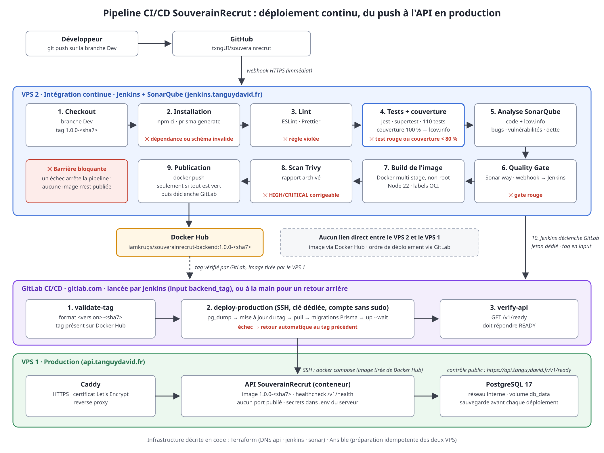

*Lecture du schéma :*
- **en bleu, le VPS 2 (intégration continue) :** un push sur GitHub déclenche Jenkins par webhook. Le code passe ensuite neuf étapes : installation, lint, **tests et couverture** (Jest, seuil de 80 %, rapport `lcov.info`), analyse SonarQube, **Quality Gate**, construction de l'image et scan **Trivy**. Les marques ✕ rouges sont des barrières bloquantes : au moindre échec, aucune image n'est publiée ;
- **au centre, Docker Hub :** l'image validée y est publiée sous un tag `1.0.0-<sha7>` ;
- **en violet, GitLab :** **Jenkins le déclenche automatiquement** avec ce tag (jeton de déclenchement). Il valide le tag, puis déploie par SSH sur le VPS 1, avec sauvegarde de la base et **retour automatique en cas d'échec**. Il vérifie enfin l'API. La CI n'a **aucun accès direct** à la production ;
- **en vert, le VPS 1 (production) :** Caddy (HTTPS), l'API et PostgreSQL sur un réseau interne.

Version vectorielle : [`schemas/pipeline.svg`](documentation/schemas/pipeline.svg).

---

## Sommaire

0. [Documents du livrable : où les trouver et pourquoi les lire](#0-documents-du-livrable--où-les-trouver-et-pourquoi-les-lire)
1. [Contexte et objectif](#1-contexte-et-objectif)
2. [Architecture mise en œuvre](#2-architecture-mise-en-œuvre)
3. [Tests automatisés et couverture](#3-tests-automatisés-et-couverture)
4. [Analyse SonarQube et Quality Gate](#4-analyse-sonarqube-et-quality-gate)
5. [Serveur d'intégration continue (VPS 2)](#5-serveur-dintégration-continue-vps-2)
6. [Pipeline CI (Jenkinsfile)](#6-pipeline-ci-jenkinsfile)
7. [Image Docker et scan Trivy](#7-image-docker-et-scan-trivy)
8. [Publication Docker Hub](#8-publication-docker-hub)
9. [Gestion des secrets](#9-gestion-des-secrets)
10. [Bilan et pistes d'amélioration](#10-bilan-et-pistes-damélioration)
11. [Déploiement (jour 2)](#11-déploiement-jour-2)
12. [Annexe A : commandes exécutées](#annexe-a--commandes-exécutées)

---

## 0. Documents du livrable : où les trouver et pourquoi les lire

Ce rapport donne une **vue synthétique** de la démarche et des résultats. Il est reproduit à l'identique dans le `README.md` du dépôt (page d'accueil GitHub), par le script [`sync-readme.py`](documentation/sync-readme.py). Le détail technique, les fichiers exécutables et les preuves se trouvent dans les documents ci-dessous. Les chemins sont relatifs à la racine du dépôt [github.com/txngUI/souverainrecrut](https://github.com/txngUI/souverainrecrut) (branche `Dev`). Le dossier `deploiement/` est aussi publié dans le projet GitLab [`tanguy-cicd/souverainrecrut-deploiement`](https://gitlab.com/tanguy-cicd/souverainrecrut-deploiement) (privé, accès sur invitation), où s'exécute la pipeline de déploiement.

### 0.1 Documentation (`documentation/`)

| Document | Contenu | Pourquoi le consulter |
|---|---|---|
| [`architecture.md`](documentation/architecture.md) | Schéma complet de la chaîne, rôle de chaque outil, flux en 11 étapes du commit au déploiement, exposition réseau, choix techniques | Comprendre **comment les pièces s'assemblent** et **pourquoi** ces choix ont été faits |
| [`gestion-des-secrets.md`](documentation/gestion-des-secrets.md) | **Inventaire de tous les secrets** (rôle, lieu de stockage, identifiant, statut), procédures de création, rotation et révocation, incident traité, vérification avant livraison | Vérifier qu'**aucun secret n'est dans le dépôt** et savoir où chacun est réellement stocké (credentials Jenkins, variables GitLab, serveur). C'est aussi la procédure à suivre en cas de fuite. |
| [`procedure-deploiement.md`](documentation/procedure-deploiement.md) | Mise en place initiale, déploiement courant, vérifications, déploiement de secours, dépannage | **Reproduire** le déploiement pas à pas (exigence de reproductibilité du §7) |
| [`procedure-rollback.md`](documentation/procedure-rollback.md) | Choix de la procédure selon la situation, redéploiement d'un tag précédent, restauration de la base (procédure testée), configuration du serveur | **Revenir à une version antérieure** en cas d'incident (exigence de continuité du §7) |
| [`captures/`](documentation/captures/) | Captures d'écran des principales étapes | **Preuves visuelles**, insérées dans ce rapport |
| [`schemas/`](documentation/schemas/) | Schéma de la pipeline complète (`pipeline.svg`, `pipeline.png`) | Comprendre **d'un coup d'œil** tout le cheminement, du push à l'API déployée |

### 0.2 Intégration continue (`integration-continue/`)

| Élément | Contenu | Pourquoi le consulter |
|---|---|---|
| [`README.md`](integration-continue/README.md) | Mise en place des tests, lint, lab Jenkins + SonarQube, analyse Sonar, pipeline et image | Détail technique **complet** de la partie CI, avec toutes les commandes |
| [`Jenkinsfile`](integration-continue/Jenkinsfile) | Pipeline CI versionnée (*pipeline as code*) | Voir exactement les étapes et les **barrières bloquantes** exécutées par Jenkins |
| [`lab/`](integration-continue/lab/) | `docker-compose.yml` (Jenkins, SonarQube, PostgreSQL), surcouche `docker-compose.vps.yml` (Caddy HTTPS, limites mémoire), image Jenkins, `.env.example` | **Recréer le serveur d'intégration continue**, en local ou sur le VPS 2 |
| [`reports/`](integration-continue/reports/) | Rapport de couverture des tests, rapport Trivy complet | **Résultats bruts** des tests et du scan de l'image |
| [`sonar/`](integration-continue/sonar/) | Exports de l'API SonarQube avant et après corrections | **Résultats bruts** de l'analyse de qualité |

### 0.3 Déploiement (`deploiement/`)

| Élément | Contenu | Pourquoi le consulter |
|---|---|---|
| [`README.md`](deploiement/README.md) | Serveur cible, Terraform, SSH, Ansible, Docker Compose, pipeline GitLab, problèmes rencontrés | Détail technique **complet** de la partie déploiement |
| [`terraform/`](deploiement/terraform/) | `providers.tf`, `variables.tf`, `main.tf`, `outputs.tf`, verrou de version | Infrastructure décrite en code : DNS de l'API (VPS 1) et des outils de CI (VPS 2) |
| [`ansible/`](deploiement/ansible/) | Inventaire des deux VPS, `playbook.yml` (production), `playbook-ci.yml` (CI), tâches Docker communes, modèles Caddy | Préparation **automatisée et idempotente** des deux serveurs |
| [`deployment/`](deploiement/deployment/) | `docker-compose.yml`, `.env.example` | Description des services en production et de leur configuration (sans secret) |
| [`.gitlab-ci.yml`](deploiement/.gitlab-ci.yml) | Pipeline de déploiement | Voir comment un tag est validé, déployé, vérifié, et annulé automatiquement en cas d'échec |
| [`reports/`](deploiement/reports/) | Sorties de la simulation et de l'application Ansible | **Résultats bruts** de la préparation du serveur |

### 0.4 Code et configuration du backend (`backend/`)

| Élément | Pourquoi le consulter |
|---|---|
| `tests/`, `jest.config.js`, `tsconfig.test.json` | Tests unitaires et d'intégration, seuil de couverture |
| `eslint.config.mjs`, `.prettierrc.json` | Règles de qualité et de formatage appliquées dans la pipeline |
| `sonar-project.properties` | Paramètres de l'analyse SonarQube |
| `Dockerfile`, `.dockerignore`, `.trivyignore.yaml` | Construction de l'image et **exceptions Trivy justifiées et datées** |

---

### 0.5 Plateformes et services

| Plateforme | Lien | Accès |
|---|---|---|
| **GitLab : pipeline de déploiement** | https://gitlab.com/tanguy-cicd/souverainrecrut-deploiement | Projet **privé**, accès sur invitation (rôle *Reporter*). Son contenu est identique au dossier [`deploiement/`](deploiement/) de ce dépôt, publié avec `git subtree`. |
| Docker Hub : image de l'API | https://hub.docker.com/r/iamkrugs/souverainrecrut-backend | Public |
| Jenkins : intégration continue (VPS 2) | https://jenkins.tanguydavid.fr | Authentification requise |
| SonarQube : qualité du code (VPS 2) | https://sonar.tanguydavid.fr | Authentification requise |
| API en production (VPS 1) | https://api.tanguydavid.fr/v1/health · [Swagger](https://api.tanguydavid.fr/api-docs) | Public |

**Chaîne complète :** `git push` sur `Dev` (GitHub) → webhook → Jenkins sur le VPS 2 (tests, SonarQube, Quality Gate, Trivy) → image sur Docker Hub → pipeline GitLab → déploiement sur le VPS 1.

### 0.6 Étapes réalisées

Chaque étape renvoie à sa documentation détaillée. Toutes les commandes exécutées sont regroupées dans l'[annexe A](#annexe-a--commandes-exécutées).

#### Partie 1 : intégration continue (cahier des charges §3)

| # | Étape | Résultat | Détail |
|---|---|---|---|
| 1 | **Préparation du dépôt** : fork, clone, branche `Dev`, `npm ci`, `prisma generate` | Backend installable | [README CI §1](integration-continue/README.md) |
| 2 | **Tests automatisés** : Jest, ts-jest, supertest ; Prisma simulé ; tests unitaires et d'intégration (authentification, rôles, candidats, offres, candidatures, santé) | **110 tests, couverture de 100 %**, seuil bloquant à 80 %, rapport `lcov.info` | [README CI §2](integration-continue/README.md) · [rapport](integration-continue/reports/) |
| 3 | **Qualité du code** : ESLint et Prettier | Lint et formatage vérifiés dans la pipeline | [README CI §3](integration-continue/README.md) |
| 4 | **Lab local** : Jenkins + SonarQube + PostgreSQL en Docker Compose | Lab validé sur le poste de travail | [README CI §4](integration-continue/README.md) |
| 5 | **Analyse SonarQube** et Quality Gate, avec correction des issues (en-tête `X-Powered-By`, `Number.parseInt`) | Quality Gate **Passed**, 0 bug, 0 vulnérabilité, 0 code smell | [README CI §5](integration-continue/README.md) · [exports](integration-continue/sonar/) |
| 6 | **Dockerfile** revu : Node 22, multi-stage, utilisateur non-root, healthcheck, sans npm, `.dockerignore` | Image légère et sans secret | [rapport §7](documentation/rapport-final.md) |
| 7 | **Scan Trivy**, avec une politique explicite : blocage des HIGH/CRITICAL corrigeables ; exception justifiée et datée | 1 CRITICAL et 26 HIGH au départ, **0 CRITICAL** après correction | [rapport Trivy](integration-continue/reports/) |
| 8 | **Jenkins** : credentials (`sonar-token`, `dockerhub`), serveur SonarQube, webhook Quality Gate, job sur `Dev`, [`Jenkinsfile`](integration-continue/Jenkinsfile) versionné | Pipeline verte : tests → SonarQube → Quality Gate → image → Trivy → publication | [rapport §6](documentation/rapport-final.md) |
| 9 | **Publication sur Docker Hub** : tags `1.0.0-<sha7>` et `sha-<sha7>`, labels OCI, jamais `latest` | Image traçable jusqu'au commit | [Docker Hub](https://hub.docker.com/r/iamkrugs/souverainrecrut-backend) |
| 10 | **Contrôle des secrets** : inventaire, scan gitleaks | `no leaks found` ; aucun `.env` réel versionné | [gestion des secrets](documentation/gestion-des-secrets.md) |

#### Partie 2 : provisionnement et déploiement (cahier des charges §4 et §5)

| # | Étape | Résultat | Détail |
|---|---|---|---|
| 11 | **Serveur de production (VPS 1)** à la place d'une VM VMware (joignable par GitLab, exposition réelle) ; sauvegarde de configuration à la place du snapshot | Point de restauration avant toute modification | [README déploiement §1](deploiement/README.md) |
| 12 | **Terraform** (provider Hostinger) : DNS `api.tanguydavid.fr` (A + AAAA) | `2 to add, 0 to change, 0 to destroy`, puis `Apply complete` | [README déploiement §2](deploiement/README.md) |
| 13 | **Accès SSH** : clé d'administration (Ansible) et clé de déploiement dédiée (GitLab, compte `souverainrecrut` sans sudo) | Rôles séparés | [README déploiement §3](deploiement/README.md) |
| 14 | **Ansible** (`playbook.yml`) : dépendances, Docker, compte de déploiement, répertoire, site Caddy en HTTPS ; simulation `--check` avant application | `failed=0`, puis `changed=0` à la 2e exécution (idempotence) | [README déploiement §4](deploiement/README.md) |
| 15 | **Docker Compose** : API + PostgreSQL, volume persistant, réseau interne, healthchecks, migrations Prisma dans un conteneur dédié ; testé en local avant déploiement | API en ligne : `https://api.tanguydavid.fr/v1/ready` → `READY / CONNECTED` | [README déploiement §5](deploiement/README.md) |
| 16 | **Pipeline GitLab** ([`.gitlab-ci.yml`](deploiement/.gitlab-ci.yml)) : validation du tag, SSH, sauvegarde de la base, pull, migrations, démarrage, **retour automatique en cas d'échec**, vérification de l'API | Déploiement réussi par la pipeline | [README déploiement §6](deploiement/README.md) |
| 17 | **Incident de sécurité traité** : clé de déploiement exposée dans une capture, puis révoquée et renouvelée (Ansible en mode exclusif) | Ancienne clé révoquée, empreinte vérifiée | [gestion des secrets §4.1](documentation/gestion-des-secrets.md) |
| 18 | **Procédures** de déploiement et de rollback (restauration de la base testée) | Reproductibles par un tiers | [déploiement](documentation/procedure-deploiement.md) · [rollback](documentation/procedure-rollback.md) |

#### Partie 3 : serveur d'intégration continue dédié (deux VPS)

| # | Étape | Résultat | Détail |
|---|---|---|---|
| 19 | **Terraform** : DNS `jenkins` et `sonar` vers le VPS 2 | `4 to add, 0 to change, 0 to destroy` | [README déploiement §7](deploiement/README.md) |
| 20 | **Ansible** (`playbook-ci.yml`) : Docker, pare-feu (22, 80, 443), Caddy en HTTPS, limites mémoire | `failed=0` | [README CI §8](integration-continue/README.md) |
| 21 | **Migration** du lab local vers le VPS 2 (volumes Docker) ; Docker Hub authentifié (quota anonyme partagé épuisé) | Job, credentials, projet SonarQube et Quality Gate conservés | [rapport §5](documentation/rapport-final.md) |
| 22 | **Webhook GitHub → Jenkins** (`githubPush()`) | Build lancé dès le push : *« Started by GitHub push »* | [rapport §5](documentation/rapport-final.md) |
| 23 | **Documentation** : rapport avec schéma, architecture des deux VPS, captures | CI séparée de la production, sans accès direct de l'une à l'autre | [architecture](documentation/architecture.md) |

#### Partie 4 : déploiement continu et démonstrations du retour arrière

| # | Étape | Résultat | Détail |
|---|---|---|---|
| 24 | **Démonstration du retour arrière manuel** : mise à jour vers `1.0.0-fae8904`, puis *Re-deploy* de `1.0.0-7fa9454` | `7fa9454 → fae8904 OK`, puis `fae8904 → 7fa9454 OK` | [rapport §11.7](#117-retour-arrière-rollback) |
| 25 | **Démonstration du retour automatique** : déploiement d'une image volontairement défaillante (`1.0.0-0bad000`) | `ÉCHEC, retour à 1.0.0-7fa9454` ; API restée `READY` | [rapport §11.7](#117-retour-arrière-rollback) |
| 26 | **Déploiement continu** : Jenkins déclenche la pipeline GitLab (jeton de déclenchement, tag en input) | Un `git push` met l'API à jour sans intervention : `7fa9454 → 877e485 OK` | [rapport §6](#6-pipeline-ci-jenkinsfile) |

---

## 1. Contexte et objectif

SouverainRecrut est une API REST de gestion du recrutement, développée avec Node.js 22, Express, TypeScript et Prisma (PostgreSQL). Le périmètre est **le backend uniquement**.

**Objectif :** toute modification poussée sur `Dev` est automatiquement testée, analysée, conteneurisée, scannée, puis publiée sur Docker Hub sous un tag traçable. La publication n'a lieu que si tous les contrôles sont verts.

## 2. Architecture mise en œuvre

> 📄 Version détaillée, avec flux, réseau, secrets et justification des choix : [`architecture.md`](documentation/architecture.md)

### 2.1 Deux VPS qui interagissent : la CI séparée de la production

La chaîne s'appuie sur **deux serveurs distincts**, comme le recommande la bonne pratique : **l'environnement qui construit le logiciel est séparé de celui qui l'exécute**.

| Serveur | Rôle | Services |
|---|---|---|
| **VPS 2 — intégration continue** | Construire, tester, analyser, publier | Jenkins, SonarQube + PostgreSQL, Caddy (HTTPS) : `jenkins.tanguydavid.fr`, `sonar.tanguydavid.fr` |
| **VPS 1 — production** | Exécuter l'API | API + PostgreSQL (Docker Compose) derrière Caddy : `api.tanguydavid.fr` |

**Comment ils interagissent :**

| Interaction | Sens | Moyen |
|---|---|---|
| Un push déclenche la CI | GitHub → **VPS 2** | Webhook HTTPS (`/github-webhook/`) |
| La CI publie une image validée | **VPS 2** → Docker Hub | `docker push`, compte authentifié |
| La CI demande le déploiement | **VPS 2** → GitLab | Appel API avec un **jeton de déclenchement** limité au projet de déploiement, et le tag en input |
| Le déploiement est exécuté | GitLab → **VPS 1** | SSH, clé dédiée, compte sans sudo |
| La production récupère l'image | Docker Hub → **VPS 1** | `docker pull` du tag demandé |
| CI → production | **VPS 2 ✕ VPS 1** | **Aucun lien direct** : la CI ne fait que publier une image et demander un déploiement. Elle ne possède ni clé, ni accès, ni identifiant de production. |

**Pourquoi c'est la bonne pratique :**
- **Moindre privilège :** Jenkins exécute du code et pilote Docker. Le compromettre ne donne **aucun accès** à la production : il n'en possède ni clé ni identifiant.
- **Isolation des ressources :** les builds (npm, tests, analyse, image) ne consomment jamais la mémoire ni le CPU de l'API.
- **Indépendance :** la CI peut être arrêtée ou reconstruite sans coupure de l'API, et une version publiée reste déployable même si la CI est indisponible.
- **Traçabilité :** ce qui passe d'un monde à l'autre se résume à un tag d'image immuable et à l'ordre de le déployer.

### 2.2 Vue d'ensemble

```
Développeur ──git push──▶ GitHub (Dev) ──webhook──┐                 GitHub ──subtree──▶ GitLab.com
                                                   ▼                                    (pipeline de
┌─────────────── VPS 2 : INTÉGRATION CONTINUE ───────────────┐  jeton de déclenchement  déploiement)
│ Caddy HTTPS ─▶ Jenkins ──analyse──▶ SonarQube ─▶ PostgreSQL │ ───────────────────────▶      │
│                  ▲ ◀──── Quality Gate ────┘                 │   (tag en input)               │ SSH
│                  └─▶ build de l'image + scan Trivy          │                               │
└──────────────────────────────┬──────────────────────────────┘                               │
                               │ docker push (si tout est vert)                               │
                               ▼                                                              ▼
                 Docker Hub : iamkrugs/souverainrecrut-backend ──docker pull──▶ ┌─── VPS 1 : PRODUCTION ───┐
                               :<version>-<sha7>                                │ Caddy HTTPS ─▶ API ─▶ PG │
                                                                                └──────────────────────────┘
                     Aucun lien direct entre le VPS 2 et le VPS 1 (pas de clé, pas d'accès)
```

### 2.3 Outils

| Outil | Rôle |
|---|---|
| **Git / GitHub** | Source de vérité du code ; la branche `Dev` déclenche la pipeline |
| **Jest, ts-jest, supertest** | Tests unitaires et d'intégration HTTP, rapport de couverture |
| **ESLint, Prettier** | Règles de code et formatage, vérifiés dans la pipeline |
| **SonarQube** | Analyse statique (bugs, vulnérabilités, code smells, duplications, couverture) et Quality Gate |
| **Jenkins** | Orchestration de la pipeline, décrite dans un Jenkinsfile versionné |
| **Docker** | Construction d'une image immuable et reproductible |
| **Trivy** | Scan des vulnérabilités de l'image avant publication |
| **Docker Hub** | Registre de l'image versionnée, publiée par le VPS 2 et récupérée par le VPS 1 |
| **Terraform** | DNS `api`, `jenkins`, `sonar` (provider Hostinger) |
| **Ansible** | Préparation des deux serveurs (`playbook.yml`, `playbook-ci.yml`) |
| **GitLab CI/CD** | Déploiement d'un tag d'image sur le VPS 1, déclenché automatiquement par Jenkins (ou à la main pour un retour arrière) |


## 3. Tests automatisés et couverture

> 📄 Détail : [`integration-continue/README.md`](integration-continue/README.md) §2 · Code : `backend/tests/` · Rapport brut : [`integration-continue/reports/`](integration-continue/reports/)

**Choix :** Jest + ts-jest (tests TypeScript typés) et supertest (requêtes HTTP réelles sur l'application Express, sans ouvrir de port). Le client Prisma est **simulé** : les tests sont rapides, déterministes et n'ont pas besoin de PostgreSQL dans la pipeline.

| Niveau | Périmètre |
|---|---|
| Unitaires (`tests/unit`) | Pagination, middlewares (JWT, rôles, validation Zod, erreurs), 8 services, configuration |
| Intégration (`tests/integration`) | Toutes les routes : authentification, utilisateurs, candidats, offres, candidatures, dashboard, santé |

Points couverts : login valide ou invalide, token absent, falsifié ou expiré (401), rôle insuffisant (403), validation (400), doublons (409), ressources absentes (404), erreur interne masquée (500), absence de l'en-tête `X-Powered-By`.

**Résultat : 19 suites, 110 tests, 100 % de couverture** (instructions, branches, fonctions, lignes). Un seuil de **80 %** est imposé dans `jest.config.js` : en dessous, la pipeline échoue.

Rapport complet : [`integration-continue/reports/couverture-tests-2026-11-09.txt`](integration-continue/reports/couverture-tests-2026-11-09.txt)

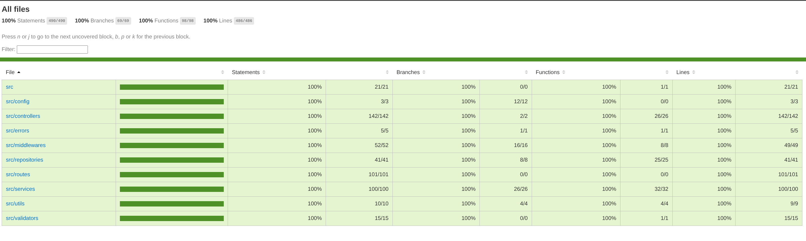

## 4. Analyse SonarQube et Quality Gate

> 📄 Détail et commandes : [`integration-continue/README.md`](integration-continue/README.md) §5 · Résultats bruts : [`integration-continue/sonar/`](integration-continue/sonar/)

Configuration versionnée dans `backend/sonar-project.properties` (sources, tests, exclusions, rapport `lcov`). Quality Gate : **Sonar way** (couverture du nouveau code ≥ 80 %, aucun nouveau bug ni vulnérabilité, duplications ≤ 3 %).

| Indicateur | 1re analyse | Après corrections |
|---|---|---|
| Quality Gate | Passed | **Passed** |
| Bugs | 0 | 0 |
| Vulnérabilités | 1 | **0** |
| Code smells | 2 | **0** |
| Security hotspots | 0 | 0 |
| Duplications | 0,0 % | 0,0 % |
| Couverture | 99,8 % | 99,8 % |

| Règle | Constat | Correction |
|---|---|---|
| S5689 (sécurité) | Express révèle sa présence via l'en-tête `X-Powered-By` | `app.disable("x-powered-by")` + test associé |
| S7773 ×2 | Usage de `parseInt` global | `Number.parseInt` |

Exports bruts de l'API : [`integration-continue/sonar/`](integration-continue/sonar/)

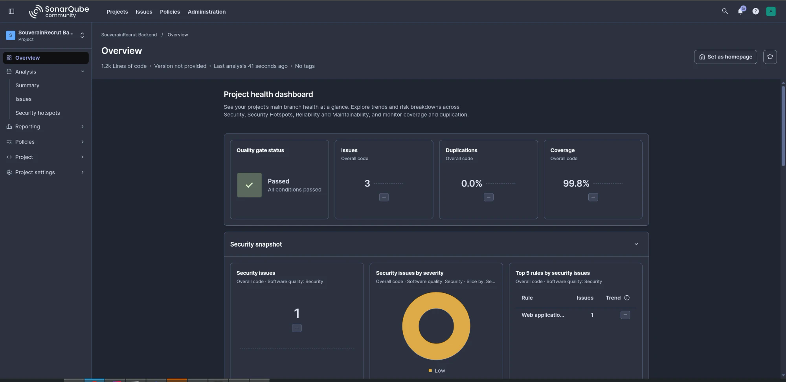
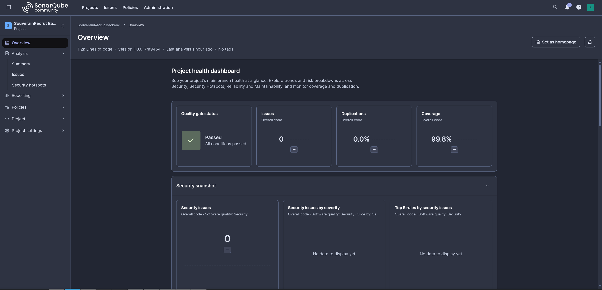

## 5. Serveur d'intégration continue (VPS 2)

> 📄 Lab : [`integration-continue/lab/`](integration-continue/lab/) (`docker-compose.yml` + surcouche `docker-compose.vps.yml`) · Préparation du serveur : [`deploiement/ansible/playbook-ci.yml`](deploiement/ansible/playbook-ci.yml) · DNS : [`deploiement/terraform/`](deploiement/terraform/) · Secrets : [`gestion-des-secrets.md`](documentation/gestion-des-secrets.md) §2.1

### 5.1 Démarche : valider en local, puis migrer

| Étape | Réalisation |
|---|---|
| 1. Lab local | Jenkins + SonarQube + PostgreSQL en Docker Compose sur le poste, accessibles en `127.0.0.1`. Configuration complète et premiers builds validés. Déclenchement par *Poll SCM*, car GitHub ne peut pas joindre un poste local. |
| 2. DNS | Terraform ajoute `jenkins.tanguydavid.fr` et `sonar.tanguydavid.fr` (A + AAAA) vers le VPS 2 : `4 to add, 0 to change, 0 to destroy` |
| 3. Préparation du VPS 2 | Ansible (`playbook-ci.yml`) : dépendances, `vm.max_map_count` pour SonarQube, Docker (tâches communes avec la production), **pare-feu `ufw`** (22, 80, 443 uniquement), fichiers du lab, Caddy |
| 4. Migration | Les volumes Docker (Jenkins, base et données de SonarQube) sont transférés du poste vers le VPS 2 par SSH. Le job, les credentials, le projet SonarQube, le Quality Gate et le webhook sont **conservés à l'identique**. SonarQube redémarre avec le même identifiant de serveur. |
| 5. Démarrage | `ansible-playbook playbook-ci.yml --tags start` : construction de l'image Jenkins et démarrage. Certificats Let's Encrypt obtenus automatiquement par Caddy. |
| 6. Déclenchement par webhook | Plugin Jenkins `github` et `githubPush()` dans le Jenkinsfile. Webhook GitHub → `https://jenkins.tanguydavid.fr/github-webhook/` : le build démarre **dès le push** (*« Started by GitHub push »*). |

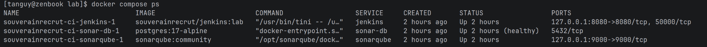

### 5.2 Configuration

| Élément | Configuration |
|---|---|
| Image Jenkins | LTS JDK 21 + Docker CLI + Node.js 22 + plugins (Git, Pipeline, SonarQube, Credentials Binding, GitHub) |
| Exposition | Caddy en HTTPS ; Jenkins et SonarQube ne publient **aucun port** ; pare-feu : 22, 80, 443 uniquement |
| Accès | Compte administrateur Jenkins avec mot de passe fort (mot de passe initial supprimé avant l'exposition), aucun accès anonyme ; SonarQube avec authentification obligatoire |
| Ressources | Limites mémoire : Jenkins 3 Go, SonarQube 3 Go (Java bridé), base 512 Mo, Caddy 256 Mo ; images supprimées après chaque build pour préserver le disque |
| Docker Hub | Serveur authentifié (token en lecture seule) : le quota anonyme de téléchargement, partagé par l'IPv6 de l'hébergeur, était épuisé (`429 Too Many Requests`) |
| SonarQube | Serveur `sonarqube` déclaré dans Jenkins ; webhook Quality Gate → `http://jenkins:8080/sonarqube-webhook/` (réseau Docker interne) |

**Compromis assumé :** Jenkins pilote Docker via le socket de l'hôte, ce qui lui donne des droits élevés **sur le VPS 2**. C'est précisément pour cette raison que la CI est sur un serveur séparé, sans aucun accès à la production.

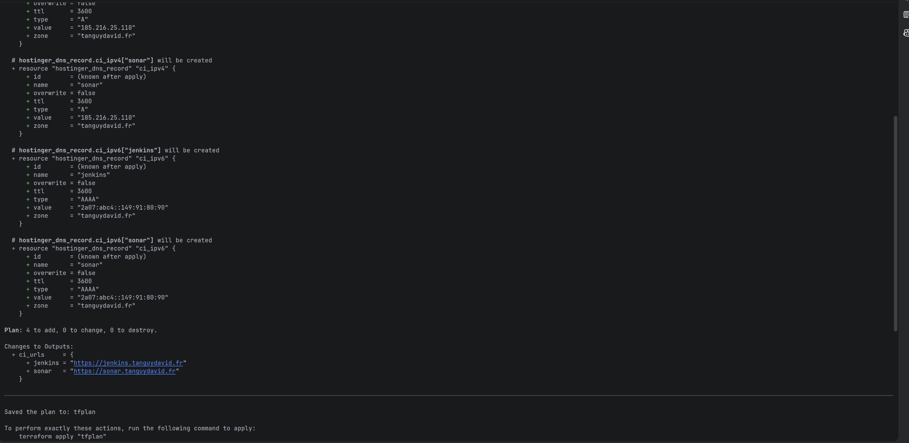
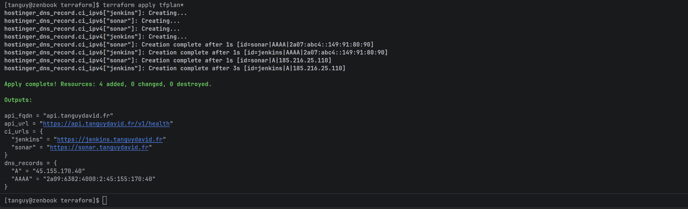
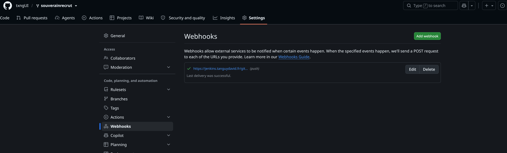
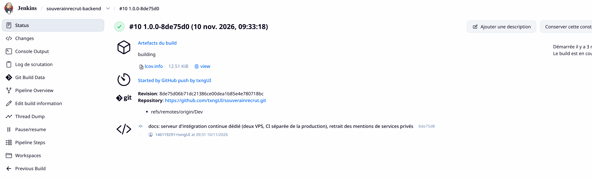
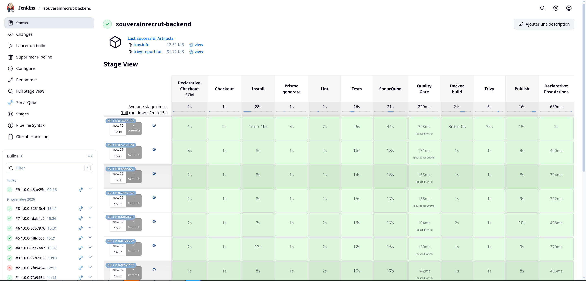
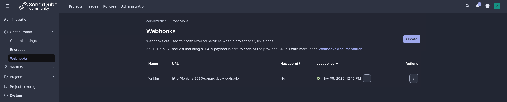
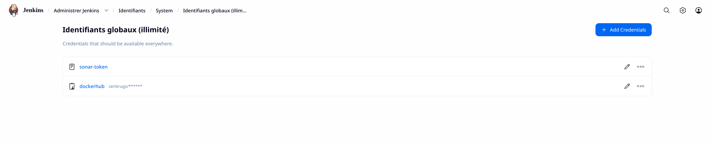
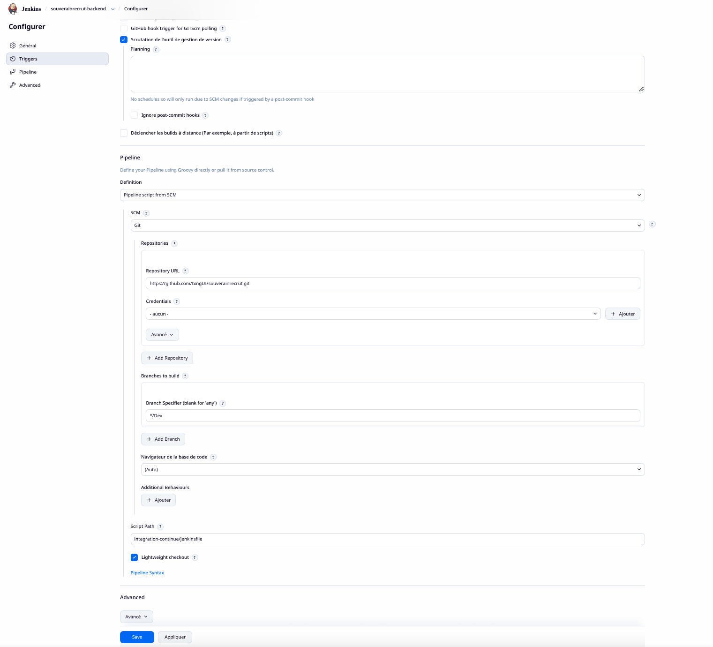

## 6. Pipeline CI (Jenkinsfile)

Fichier versionné : [`integration-continue/Jenkinsfile`](integration-continue/Jenkinsfile). Déclenchement : **webhook GitHub** (`githubPush()`) à chaque push sur `Dev`.

| # | Étape | Rôle | Échec si… |
|---|---|---|---|
| 1 | Checkout | Récupère `Dev`, calcule le tag `version-sha` | — |
| 2 | Install | `npm ci` (versions exactes du lockfile) | dépendance introuvable |
| 3 | Prisma generate | Génère le client Prisma | schéma invalide |
| 4 | Lint | ESLint + vérification Prettier | règle violée |
| 5 | Tests | Tests + couverture | test rouge ou couverture < 80 % |
| 6 | SonarQube | Envoie l'analyse | — |
| 7 | Quality Gate | Attend le verdict de SonarQube (webhook) | gate rouge |
| 8 | Docker build | Connexion à Docker Hub, puis image taguée et étiquetée (version, commit, source) | build KO |
| 9 | Trivy | Rapport archivé + contrôle bloquant | HIGH/CRITICAL corrigeable non justifiée |
| 10 | Publish | `docker push` (branche `Dev` uniquement) | authentification KO |
| 11 | Deploy (GitLab) | Déclenche la pipeline de déploiement GitLab avec le tag publié (API GitLab, jeton `gitlab-trigger-token`) | jeton invalide ou GitLab indisponible |

Les étapes sont séquentielles : **un échec arrête la pipeline, et l'image n'est ni publiée ni déployée**.

**Déploiement continu :** depuis l'étape 11, un `git push` sur `Dev` suffit pour mettre la production à jour, sans intervention. Premier déploiement automatique : `1.0.0-7fa9454 -> 1.0.0-877e485 OK (pipeline 3049563440)`, le 10/11/2026 à 12:27. Le filet de sécurité est double : les barrières de la CI (tests, Quality Gate, Trivy) d'un côté, et de l'autre le retour automatique à la version précédente si l'API ne démarre pas en production (voir §11.7).

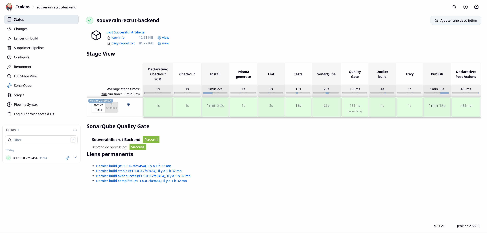
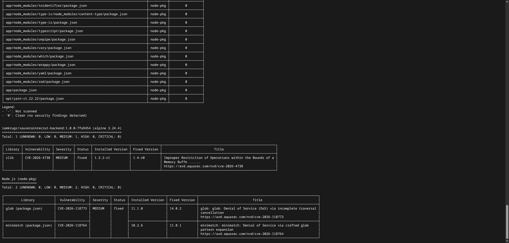

## 7. Image Docker et scan Trivy

> 📄 `backend/Dockerfile`, `backend/.dockerignore`, `backend/.trivyignore.yaml` (exceptions justifiées) · Rapport complet : [`integration-continue/reports/`](integration-continue/reports/)

**Dockerfile** (`backend/Dockerfile`) : build multi-stage `node:22-alpine`. L'image finale ne contient que `dist/`, les dépendances de production et le client Prisma. Autres caractéristiques :
- utilisateur **non-root** (`node`) ;
- **healthcheck** sur `/v1/health` ;
- npm et npx retirés ;
- `.dockerignore` excluant `.env`, les tests et `node_modules`.

**Politique Trivy (seuils acceptés) :**
- **bloquant :** toute vulnérabilité **HIGH ou CRITICAL disposant d'un correctif** ;
- **toléré :** MEDIUM et LOW, reportés dans le rapport ;
- **exceptions :** déclarées dans `backend/.trivyignore.yaml`, chacune **justifiée et datée**. À expiration, elle redevient bloquante.

| Scan de l'image | CRITICAL | HIGH | MEDIUM |
|---|---|---|---|
| Image d'origine (Node 20, root, avec npm) | 1 | 26 | — |
| Après corrections (`npm audit fix`, npm retiré) | **0** | 1 (exception) | 3 |

Exception en vigueur : **CVE-2026-40345** (`deepmerge-ts`, dépendance interne de l'outillage Prisma, non atteignable par les requêtes HTTP). Son correctif impose Prisma 7 ; l'exception expire le 31/12/2026.

Rapport complet : [`integration-continue/reports/trivy-1.0.0-7fa9454.txt`](integration-continue/reports/trivy-1.0.0-7fa9454.txt)

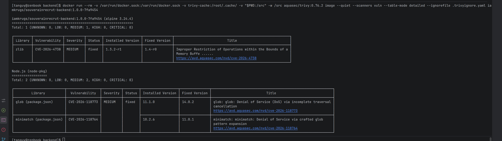

## 8. Publication Docker Hub

L'image est publiée avec deux tags traçables, sans `latest` :

- `iamkrugs/souverainrecrut-backend:1.0.0-7fa9454` : version applicative + commit ;
- `iamkrugs/souverainrecrut-backend:sha-7fa9454` : commit seul.

Les labels OCI (`org.opencontainers.image.revision`, `version`, `source`) relient l'image au commit Git.

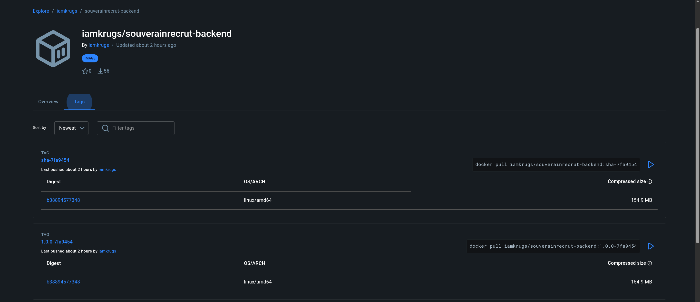

## 9. Gestion des secrets

Aucun secret dans le dépôt, le Jenkinsfile, l'image ou les logs. Les tokens SonarQube et Docker Hub sont stockés dans les **credentials Jenkins**, et le mot de passe de la base SonarQube dans un `.env` non versionné. La connexion à Docker Hub utilise `--password-stdin`, et les logs affichent `****`.

Le token est masqué (`echo ****`) dans les logs. L'avertissement Docker sur le stockage local des identifiants (`~/.docker/config.json`) est traité par un `docker logout` systématique en fin de pipeline (bloc `post { always }`).

> 📄 **Gestionnaire des secrets : [`documentation/gestion-des-secrets.md`](documentation/gestion-des-secrets.md).** C'est le document de référence sur la sécurité des accès. Il contient :
> - l'**inventaire** de chaque secret du projet (rôle, lieu de stockage, identifiant, statut) ;
> - les procédures de **création**, de **rotation** et de **révocation** ;
> - l'**incident traité** (clé de déploiement exposée puis renouvelée) ;
> - les **contrôles avant livraison** (gitleaks, absence de `.env` réel).
>
> À consulter pour vérifier qu'aucune valeur sensible n'est présente dans le livrable, et pour savoir où chacune est réellement conservée.

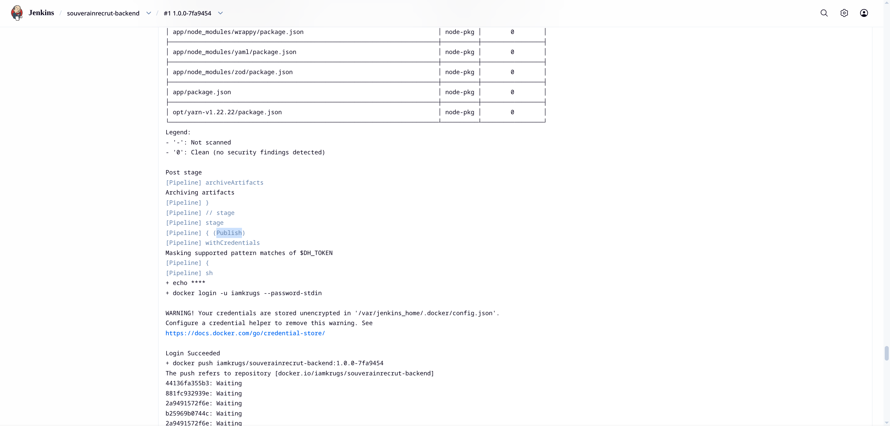

## 10. Bilan et pistes d'amélioration

**Bilan :** la chaîne est complète et répartie sur **deux VPS qui interagissent sans lien direct**. Un `git push` déclenche immédiatement la CI sur le VPS 2, qui ne publie l'image que si trois barrières bloquantes sont franchies : tests et couverture, Quality Gate, Trivy. Jenkins déclenche ensuite automatiquement GitLab, qui déploie ce tag sur le VPS 1 et revient seul à la version précédente en cas d'échec : c'est du **déploiement continu**, démontré en production.

**Démonstration d'un blocage :** le build n°2 a été rejoué (*Replay*) avec un seuil Trivy durci (`--severity MEDIUM,HIGH,CRITICAL`). Trivy détecte les 3 vulnérabilités MEDIUM et renvoie un code de sortie non nul. L'étape *Trivy* échoue, *Publish* n'est pas exécutée et aucune image n'est poussée. Le Quality Gate, lui, reste *Passed* : chaque barrière est indépendante.

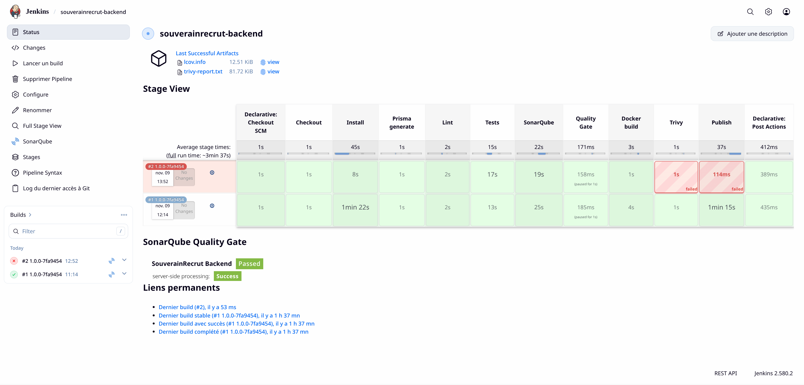

**Pistes d'amélioration :**

- Migrer vers Prisma 7, ce qui lève l'exception Trivy.
- Signer le webhook GitHub avec un secret partagé (HMAC), vérifié par Jenkins.
- Ajouter un environnement de staging et une approbation avant la production, pour combiner livraison continue et contrôle humain.
- Faire attendre à Jenkins le résultat du déploiement GitLab, pour remonter son statut dans le build.
- Ajouter un scan de secrets (gitleaks) et un audit de dépendances (`npm audit`) dans la pipeline.
- Construire l'image sur un agent de build dédié ou sans daemon (BuildKit rootless), plutôt que via le socket Docker du VPS 2.

## 11. Déploiement (jour 2)

Documentation technique détaillée : [`deploiement/README.md`](deploiement/README.md)

### 11.1 Serveur cible (VPS 1, production)

Le serveur cible est un **VPS** (PulseHeberg, Ubuntu 24.04, IP publique) au lieu d'une VM VMware locale :

- il est joignable par les runners GitLab.com, ce qui n'est pas possible pour une VM en NAT ;
- il est représentatif d'une vraie production : exposition Internet, DNS, TLS.

Ce serveur héberge déjà d'autres services, sans lien avec ce projet. Le déploiement est donc **isolé** :

- un projet Compose dédié ;
- aucun port public ouvert ;
- un fichier Caddy dédié ;
- le service Docker n'est jamais redémarré.

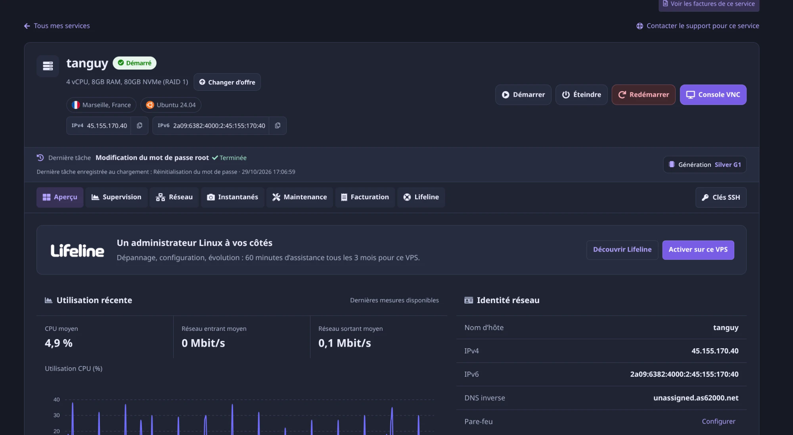

L'offre du VPS n'inclut pas d'instantanés. Le point de restauration demandé au §4.1 est remplacé par trois mesures :

- une **sauvegarde ciblée** de la configuration (Caddy, SSH, comptes) avant toute modification ;
- des **modifications uniquement additives** et réversibles ;
- une **simulation Ansible** (`--check --diff`) avant application.

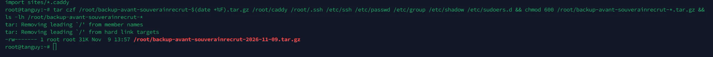

### 11.2 Terraform : DNS de l'API

> 📄 Code : [`deploiement/terraform/`](deploiement/terraform/) · Détail : [`deploiement/README.md`](deploiement/README.md) §2

PulseHeberg n'ayant pas de provider Terraform, le VPS est créé manuellement (cas prévu au §4.2). Terraform pilote la ressource réellement disponible : la **zone DNS `tanguydavid.fr` chez Hostinger** (provider officiel `hostinger/hostinger`). Il crée les enregistrements `A` et `AAAA` de `api.tanguydavid.fr` vers le serveur.

- **Sécurité :** le token API est lu dans `HOSTINGER_API_TOKEN`, saisi sans affichage. L'état `tfstate` n'est jamais versionné.
- **Non-régression :** `overwrite = false`, donc aucun enregistrement existant n'est remplacé. Avant d'appliquer, on a vérifié qu'aucun enregistrement `api` ni wildcard n'existait.
- **Commandes :** `terraform init`, `validate`, `plan -out=tfplan`, `apply tfplan`.
- **Résultat :** plan `2 to add, 0 to change, 0 to destroy`, puis `Apply complete! Resources: 2 added`. Vérifié par `dig` : `api.tanguydavid.fr` résout vers les IPv4 et IPv6 du serveur.

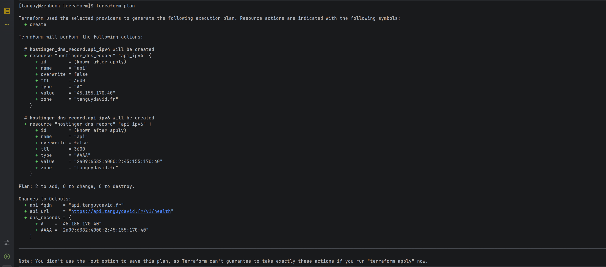
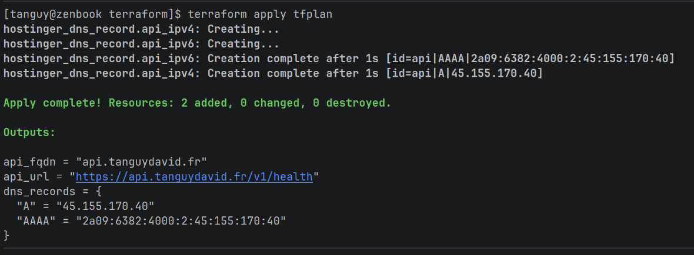

### 11.3 Accès SSH : deux clés, deux rôles

| Clé | Utilisée par | Compte | Droits |
|---|---|---|---|
| Clé personnelle (`id_ed25519`) | Ansible, depuis le poste d'administration | `root` | Administration du serveur |
| Clé de déploiement (`souverainrecrut_deploy`) | GitLab CI | `souverainrecrut` | Groupe `docker`, **sans sudo**, mot de passe verrouillé |

Un **compte dédié** au projet a été créé : il peut être révoqué indépendamment des autres comptes du serveur, et ses connexions sont traçables séparément dans les journaux SSH.

### 11.4 Ansible : préparation du serveur

> 📄 Code : [`deploiement/ansible/`](deploiement/ansible/) · Sorties d'exécution : [`deploiement/reports/`](deploiement/reports/) · Détail : [`deploiement/README.md`](deploiement/README.md) §4

Le playbook répond aux exigences du §4.3 : système et dépendances, Docker Engine et Compose, service Docker actif, répertoire de déploiement. Il est conçu pour un **serveur partagé** :

- **Mises à jour :** uniquement les mises à jour de sécurité automatiques. Pas d'`apt upgrade` complet ni de redémarrage, qui interrompraient les services hébergés.
- **Docker :** installé **seulement s'il est absent**, et le service n'est jamais redémarré.
- **Utilisateur :** création du compte `souverainrecrut`, avec sa clé et `/opt/souverainrecrut` (`0750`).
- **Caddy :** dépôt d'un fichier de site dédié, `caddy validate` puis `caddy reload` à chaud. Si la configuration est invalide, le fichier est retiré automatiquement (`block`/`rescue`).

| Exécution | Résultat |
|---|---|
| Simulation `--check --diff` | `changed=6 failed=0` ; partie Docker *skipped* car déjà installé |
| Application | `failed=0` ; site existant toujours en ligne ; certificat Let's Encrypt obtenu pour `api.tanguydavid.fr` |
| Application rejouée | `changed=0 failed=0` : **idempotence** vérifiée |

Rapports : [`deploiement/reports/`](deploiement/reports/)

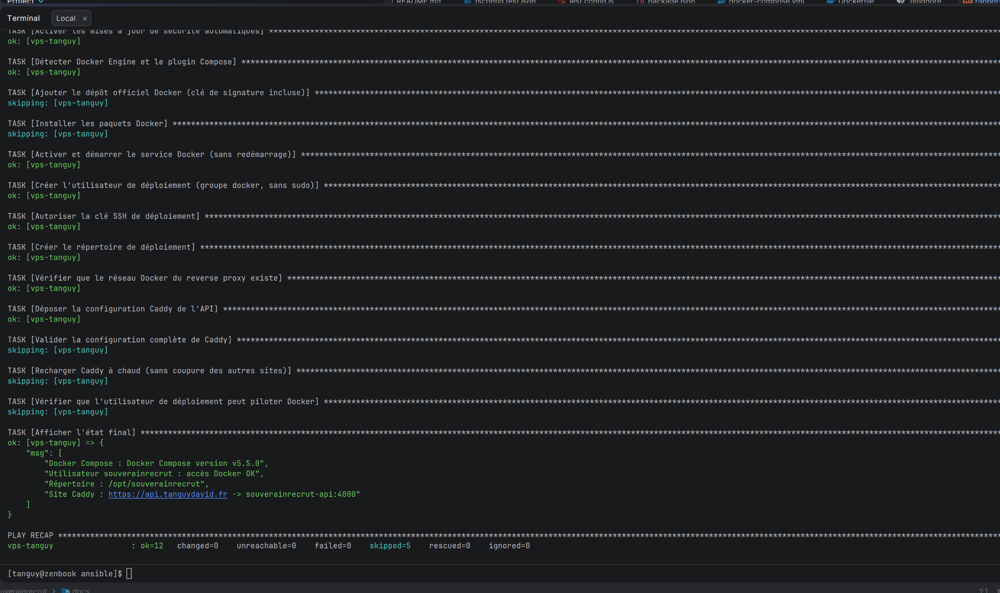
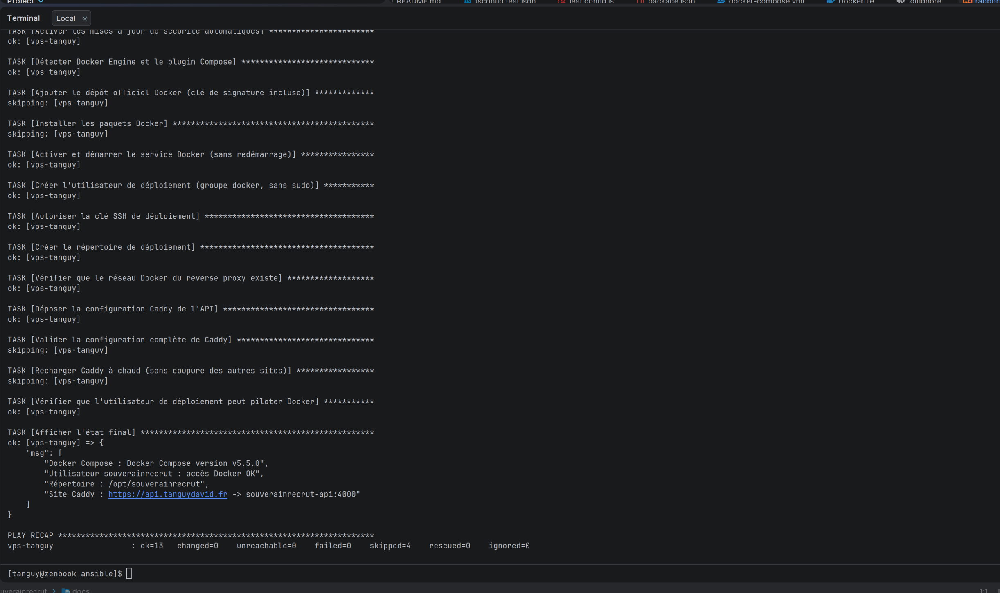
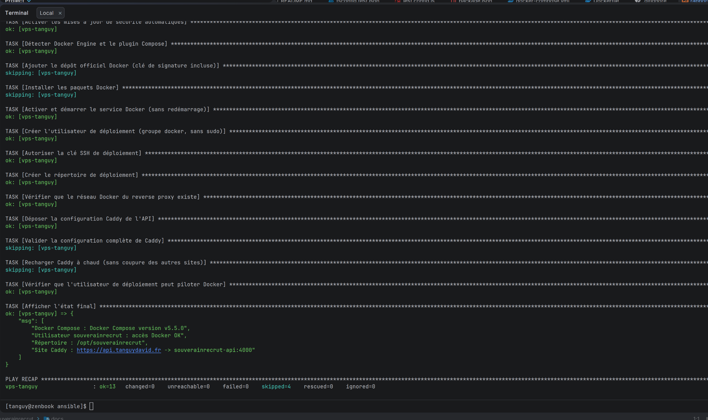

### 11.5 Docker Compose et premier déploiement

> 📄 Fichiers : [`deploiement/deployment/`](deploiement/deployment/) · Pas à pas reproductible : [`procedure-deploiement.md`](documentation/procedure-deploiement.md)

Fichiers : `deploiement/deployment/docker-compose.yml` et `.env.example`.

| Exigence §5.2 | Mise en œuvre |
|---|---|
| Image versionnée | `iamkrugs/souverainrecrut-backend:${BACKEND_TAG}`, jamais reconstruite ni `latest` |
| Variables API et Prisma | `.env` sur le serveur, droits 600, non versionné ; secrets générés sur place (`openssl rand`) |
| Volume persistant | `db_data` (PostgreSQL) |
| Réseaux | `backend` **interne** (API ↔ base, sans Internet) ; `web` (Caddy ↔ API, alias `souverainrecrut-api`) ; **aucun port publié** |
| Redémarrage et santé | `restart: unless-stopped` ; `pg_isready` pour la base ; `/v1/health` pour l'API |
| Migrations maîtrisées | Conteneur ponctuel `migrate` (`prisma migrate deploy`). L'API ne démarre que si les migrations réussissent. Le seed de démonstration n'est **pas** exécuté en production, car il vide les tables. |

Ce fichier a d'abord été **testé en local**, avec l'image publiée :
- migrations appliquées, API *healthy*, `/v1/ready` → `READY / CONNECTED` ;
- redéploiement : `No pending migrations` ;
- base injoignable depuis le réseau de Caddy.

Il a ensuite été déployé sur le serveur avec le compte de déploiement.

**Résultat :**
- `api` et `db` sont *healthy*, `migrate` s'est terminé avec le code 0 ;
- `https://api.tanguydavid.fr/v1/ready` → `READY / CONNECTED` ;
- Swagger est accessible sur `/api-docs`.

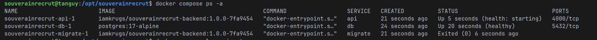
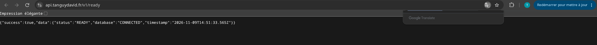
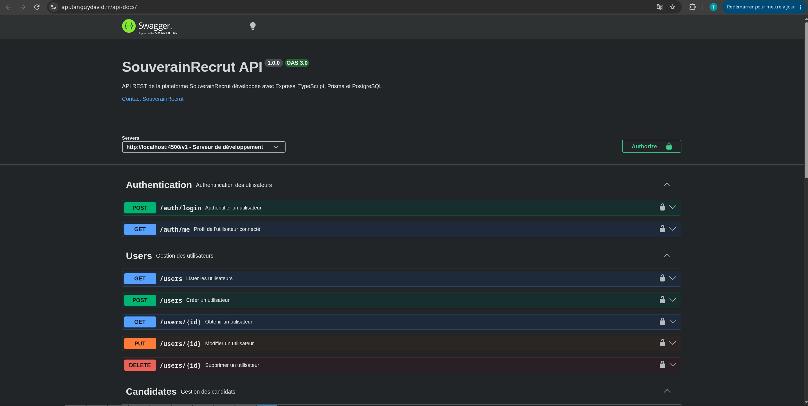

### 11.6 Pipeline GitLab CI/CD

> 📄 Pipeline : [`deploiement/.gitlab-ci.yml`](deploiement/.gitlab-ci.yml) · Variables et secrets : [`gestion-des-secrets.md`](documentation/gestion-des-secrets.md) §2.4 · Dépannage : [`procedure-deploiement.md`](documentation/procedure-deploiement.md) §6

GitLab.com (offre cloud, runners hébergés) prend en charge le **déploiement continu**, séparé de l'intégration continue faite par Jenkins :

- Jenkins s'arrête à l'image publiée sur Docker Hub ;
- GitLab part d'un **tag d'image** et le met en production.

**Mise en place du projet GitLab :**

| Étape | Réalisation |
|---|---|
| Compte et espace | Compte GitLab.com (offre Free, runners hébergés) ; groupe `tanguy-cicd` |
| Projet dédié au déploiement (§4.4) | `souverainrecrut-deploiement`, **privé** ; branche `main` protégée |
| Authentification Git | Clé SSH personnelle ajoutée au profil GitLab ; empreinte de `gitlab.com` vérifiée (`SHA256:eUXGGm1Y…CLB8`) |
| Contenu | Le dossier `deploiement/` du dépôt GitHub est publié à la racine du projet GitLab avec `git subtree`. Le dépôt GitHub reste la **source unique**, et `.gitlab-ci.yml` est à la racine côté GitLab. |
| Contrôle avant publication | Scan gitleaks du contenu commité : `no leaks found` ; état Terraform ignoré par Git |

Pousser vers GitLab n'exécute rien (règle `workflow`) : la pipeline est lancée **par Jenkins** (source `trigger`), ou **à la main** (formulaire, *Re-deploy*) pour un retour arrière.

| Job | Rôle |
|---|---|
| `validate-tag` | Refuse un tag mal formé ou `latest` ; vérifie sur Docker Hub que l'image existe |
| `deploy-production` | Envoie le fichier Compose en SSH (empreinte du serveur vérifiée) ; **sauvegarde la base** (`pg_dump`, 5 dernières conservées) ; met à jour `BACKEND_TAG` ; lance `pull` et `up --wait`. **En cas d'échec, revient automatiquement au tag précédent.** Journalise dans `deploy-history.log`. |
| `verify-api` | Vérifie que `/v1/ready` répond `READY` |

Le tag à déployer est passé par un **input** de pipeline : Jenkins le fournit à l'appel API, et il est saisi dans le formulaire de lancement en cas de déclenchement manuel (`spec:inputs`, mécanisme recommandé par GitLab à la place des variables libres). `resource_group` garantit un seul déploiement à la fois. L'environnement GitLab `production` conserve l'historique des déploiements.

**Secrets :** GitLab ne reçoit que ce que liste le §4.4 :
- la clé SSH (variable de type *File*, protégée) ;
- l'empreinte du serveur ;
- l'adresse et l'utilisateur ;
- les identifiants Docker Hub : **volontairement non créés**. L'image est publique, et la pipeline saute la connexion si ces variables sont absentes. Un secret en moins dans la CI.

Côté Jenkins, le **jeton de déclenchement** GitLab est un credential (`gitlab-trigger-token`). Il permet seulement de lancer la pipeline du projet de déploiement.

Les 4 variables créées (`SSH_PRIVATE_KEY` de type *File*, `SSH_KNOWN_HOSTS`, `DEPLOY_HOST`, `DEPLOY_USER`) sont toutes *Protected* : elles ne sont transmises qu'à la branche protégée `main`. L'empreinte du serveur a été comparée à celle déjà connue du poste d'administration (`SHA256:cHakt12…dikx1Q`).

Les secrets applicatifs **restent uniquement sur le serveur** : la pipeline ne modifie que `BACKEND_TAG`.

**Résultat du premier déploiement par la pipeline** (pipeline 3045841142, tag `1.0.0-7fa9454`) :
- les 3 jobs sont verts ;
- la base a été sauvegardée avant le déploiement ;
- le déploiement est journalisé sur le serveur ;
- l'API répond `READY / CONNECTED`.

**Difficultés rencontrées et résolues :**
- syntaxe YAML d'une ligne de script ;
- passage du tag en *input* de pipeline (`spec:inputs`), car les variables manuelles sont désactivées par défaut ;
- format de la clé collée dans la variable : la pipeline normalise désormais la clé et vérifie sa lisibilité avant usage ;
- **clé privée exposée** dans une capture pendant le diagnostic : elle a été traitée comme un incident, avec **rotation immédiate**. Ansible gère `authorized_keys` en mode exclusif, ce qui a révoqué automatiquement l'ancienne clé. L'empreinte de la clé autorisée a été vérifiée et le redéploiement a réussi (`gestion-des-secrets.md` §4.1).

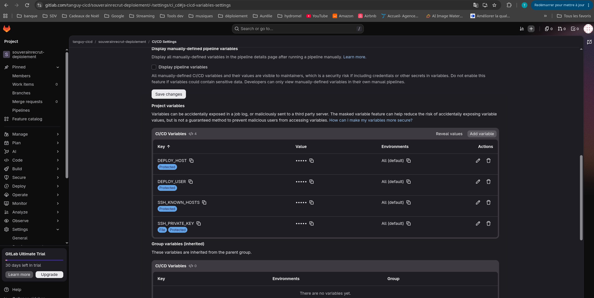
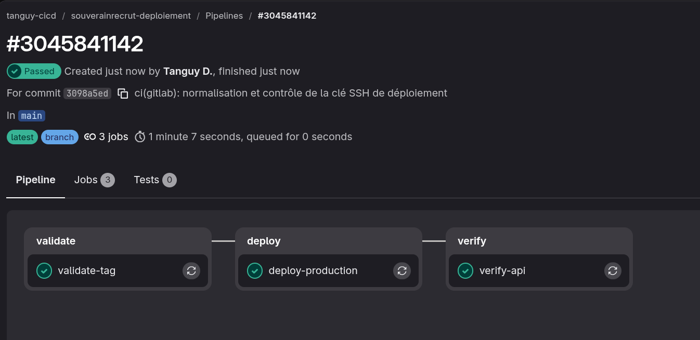
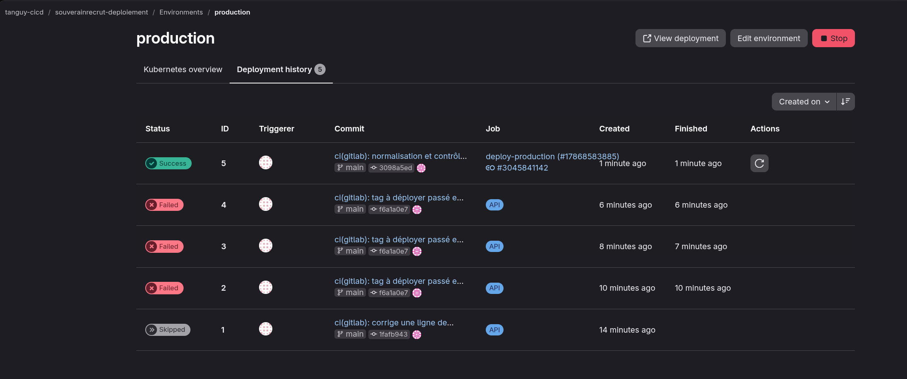

### 11.7 Retour arrière (rollback)

| Situation | Action |
|---|---|
| Le nouveau tag ne démarre pas | **Automatique** : la pipeline remet le tag précédent et redémarre |
| Régression détectée après déploiement | Relancer la pipeline avec le tag précédent, ou **Re-deploy** sur l'ancien déploiement dans *Environments → production* |
| Migration de base incompatible | Restaurer la sauvegarde `backups/db-…-avant-<tag>.sql.gz` prise automatiquement avant le déploiement, puis redéployer l'ancien tag |

Procédure détaillée et **testée** (restauration de la base vérifiée sur une copie locale) : [`procedure-rollback.md`](documentation/procedure-rollback.md).

**Démonstration 1, en production : mise à jour puis retour arrière manuel (10/11/2026)**

| Heure (UTC) | Action | Historique du serveur (`deploy-history.log`) |
|---|---|---|
| 11:28 | Pipeline GitLab avec `backend_tag` = `1.0.0-fae8904` (dernière version publiée par Jenkins) | `1.0.0-7fa9454 -> 1.0.0-fae8904 OK (pipeline 3049336709)` |
| 12:07 | *Operate → Environments → production → Re-deploy* sur l'ancien déploiement | `1.0.0-fae8904 -> 1.0.0-7fa9454 OK (pipeline 3045841142)` |

Après le retour arrière :
- la version en service est `1.0.0-7fa9454` (`docker compose images`) ;
- `api` et `db` sont *healthy* ;
- `https://api.tanguydavid.fr/v1/ready` répond `READY / CONNECTED` ;
- une sauvegarde de la base a été prise **avant chaque** déploiement.

Historique brut : [`deploiement/reports/deploy-history-2026-11-10.txt`](deploiement/reports/deploy-history-2026-11-10.txt).

> Dans GitLab, la colonne *Commit* affiche le commit du **dépôt de déploiement** (version du `.gitlab-ci.yml`), et non celui de l'application. La version de l'API déployée est le **tag d'image** saisi au lancement : ce sont deux historiques distincts, celui du code (CI) et celui du déploiement (CD). *Re-deploy* rejoue le job d'origine avec sa propre version du script et son propre tag.

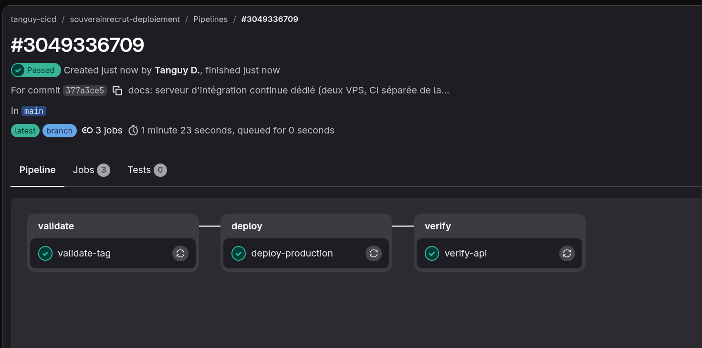
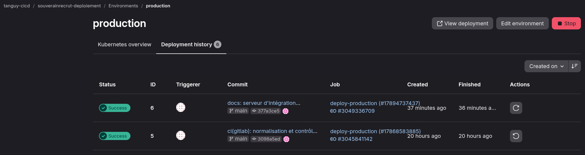
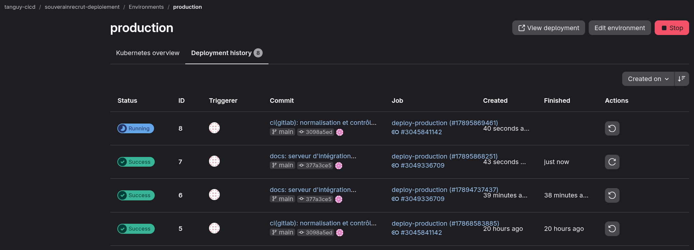

**Démonstration 2, en production : retour automatique sur une version défaillante (10/11/2026)**

Une image **volontairement en panne** a été publiée sous le tag `1.0.0-0bad000`. C'est la même API, mais avec un healthcheck qui échoue toujours. Elle simule une régression qui passe les contrôles mais casse au démarrage. Cette image de test a été construite hors de Jenkins, puis **supprimée de Docker Hub** après la démonstration.

| Étape | Résultat |
|---|---|
| `validate-tag` | ✅ Le tag existe et respecte le format : la panne n'est pas détectable avant le démarrage |
| `deploy-production` | ❌ Sauvegarde de la base, nouvelle image démarrée, API jamais *healthy* : **retour automatique** à la version précédente, puis job en échec pour signaler l'incident |
| `verify-api` | Ignoré, puisque le déploiement a échoué |
| Historique du serveur | `1.0.0-7fa9454 -> 1.0.0-0bad000 ÉCHEC, retour à 1.0.0-7fa9454 (pipeline 3049524745)` |
| Production | `https://api.tanguydavid.fr/v1/ready` → `READY / CONNECTED`, juste après l'échec : **le service n'a pas été durablement interrompu** |

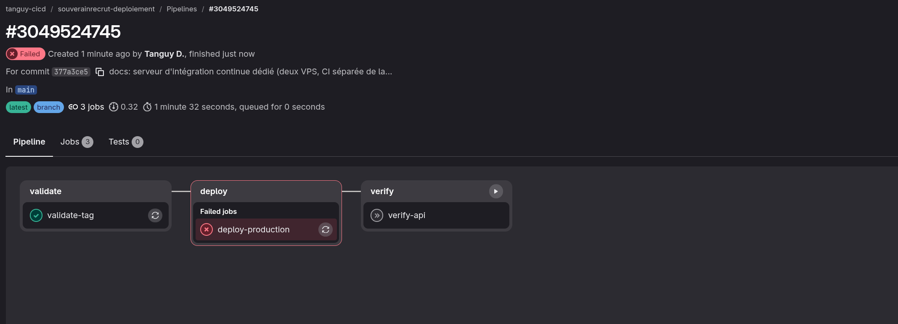
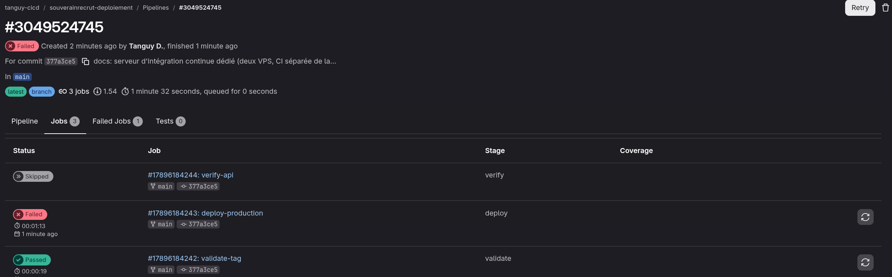
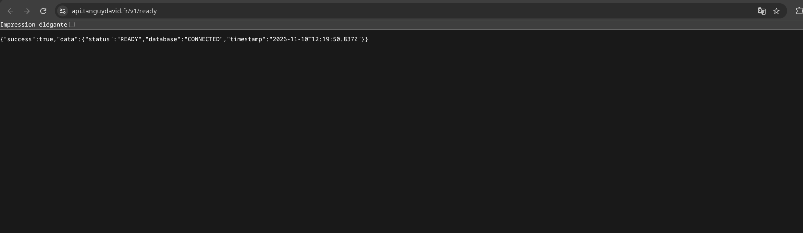

**Bilan des démonstrations :** les trois chemins de retour arrière ont été exercés en conditions réelles :
- **manuel**, par *Re-deploy* ;
- **automatique**, sur une version défaillante ;
- **restauration de la base**, testée sur une copie de l'environnement.

Chaque déploiement a été précédé d'une sauvegarde de la base.

### 11.8 Documentation de référence

La liste complète des documents, avec leur emplacement et leur intérêt, se trouve en [section 0](#0-documents-du-livrable--où-les-trouver-et-pourquoi-les-lire).

---

## Annexe A : commandes exécutées

Les commandes sont listées dans l'ordre de réalisation. Les secrets sont toujours saisis sans affichage (`read -rsp`) ou générés sur place, et n'apparaissent jamais en clair.

### A.1 Tests, lint et couverture (`backend/`)

```bash
npm ci
npx prisma generate
npm install -D jest ts-jest @types/jest supertest @types/supertest
npm install -D eslint @eslint/js typescript-eslint globals prettier eslint-config-prettier
npm run lint                  # ESLint
npm run format:check          # Prettier (vérification)
npm test                      # 110 tests
npm run test:coverage         # couverture + coverage/lcov.info
npm audit fix                 # correctifs de dépendances (sans --force)
```

### A.2 Lab Jenkins + SonarQube (`integration-continue/lab/`)

```bash
printf "SONAR_DB_PASSWORD=%s\nDOCKER_GID=%s\n" "$(openssl rand -hex 16)" \
  "$(getent group docker | cut -d: -f3)" > .env          # .env non versionné
git check-ignore -v .env                                # vérifie qu'il est ignoré
docker compose up -d --build                            # Jenkins + SonarQube + PostgreSQL
docker compose ps
docker compose logs -f sonarqube                        # attendre "SonarQube is operational"
docker compose exec jenkins cat /var/jenkins_home/secrets/initialAdminPassword
docker compose exec jenkins docker ps                   # Jenkins accède à Docker
docker compose exec jenkins node -v                     # Node.js 22 disponible
```

### A.3 Analyse SonarQube manuelle (`backend/`)

```bash
npm run test:coverage
read -rsp "Token Sonar : " SONAR_TOKEN && export SONAR_TOKEN
docker run --rm --network souverainrecrut-ci_default \
  -e SONAR_HOST_URL=http://sonarqube:9000 -e SONAR_TOKEN \
  -v "$PWD:/usr/src" sonarsource/sonar-scanner-cli
# Exports des résultats (API SonarQube)
curl -s -u "$SONAR_TOKEN:" "http://localhost:9000/api/issues/search?componentKeys=souverainrecrut-backend&ps=100"  # gitleaks:allow (variable, aucun secret)
curl -s -u "$SONAR_TOKEN:" "http://localhost:9000/api/measures/component?component=souverainrecrut-backend&metricKeys=coverage,duplicated_lines_density,bugs,vulnerabilities,code_smells,security_hotspots,ncloc"  # gitleaks:allow (variable, aucun secret)
curl -s -u "$SONAR_TOKEN:" "http://localhost:9000/api/qualitygates/project_status?projectKey=souverainrecrut-backend"  # gitleaks:allow (variable, aucun secret)
```

### A.4 Image Docker et Trivy

```bash
docker build -t iamkrugs/souverainrecrut-backend:test backend
docker run --rm -v /var/run/docker.sock:/var/run/docker.sock -v trivy-cache:/root/.cache/ \
  -v "$PWD:/src" -w /src aquasec/trivy:0.76.2 image --scanners vuln \
  --severity HIGH,CRITICAL --ignore-unfixed --exit-code 1 \
  --ignorefile backend/.trivyignore.yaml iamkrugs/souverainrecrut-backend:1.0.0-7fa9454
# Version courte (vulnérabilités uniquement)
docker run --rm -v /var/run/docker.sock:/var/run/docker.sock -v trivy-cache:/root/.cache/ \
  -v "$PWD:/src" -w /src aquasec/trivy:0.76.2 image --scanners vuln --table-mode detailed \
  --ignorefile backend/.trivyignore.yaml iamkrugs/souverainrecrut-backend:1.0.0-7fa9454
```

Dans la pipeline Jenkins, la publication se fait par `echo "$DH_TOKEN" | docker login -u "$DH_USER" --password-stdin`, puis `docker push` des tags `1.0.0-<sha7>` et `sha-<sha7>`.

### A.5 Contrôle des secrets (racine du dépôt)

```bash
docker run --rm -v "$PWD:/repo" zricethezav/gitleaks:latest detect --source /repo   # → no leaks found
git ls-files | grep -E '(^|/)\.env'                                                # seuls des .env.example
```

### A.6 Serveur : état des lieux et sauvegarde (VPS, en root)

```bash
docker --version; docker compose version; ss -tlnp      # ports et services existants
docker ps --format 'table {{.Names}}\t{{.Image}}\t{{.Ports}}'
docker network ls
tar czf /root/backup-avant-souverainrecrut-$(date +%F).tar.gz \
  /root/caddy /root/.ssh /etc/ssh /etc/passwd /etc/group /etc/shadow /etc/sudoers.d
chmod 600 /root/backup-avant-souverainrecrut-*.tar.gz
```

### A.7 Terraform (`deploiement/terraform/`)

```bash
dig +short api.tanguydavid.fr A                         # vérifier qu'aucun enregistrement n'existe
read -rsp "Token Hostinger : " HOSTINGER_API_TOKEN && export HOSTINGER_API_TOKEN
terraform init
terraform validate
terraform plan -out=tfplan                              # 2 to add, 0 to change, 0 to destroy
terraform apply tfplan
terraform output
dig +short api.tanguydavid.fr A && dig +short api.tanguydavid.fr AAAA
```

### A.8 Clés SSH (poste d'administration)

```bash
ssh-copy-id -i ~/.ssh/id_ed25519.pub root@45.155.170.40          # accès Ansible par clé
ssh root@45.155.170.40 'echo OK && python3 --version'
ssh-keygen -t ed25519 -C "deploy-souverainrecrut" -f ~/.ssh/souverainrecrut_deploy -N ""
```

### A.9 Ansible (`deploiement/ansible/`)

```bash
ansible production -m ping
ansible-playbook playbook.yml --check --diff            # simulation
ansible-playbook playbook.yml --diff                    # application
ansible-playbook playbook.yml --diff | tee ../reports/ansible-apply-2026-11-09.txt   # rejouée : changed=0
ssh -i ~/.ssh/souverainrecrut_deploy souverainrecrut@45.155.170.40 'whoami && id && ls -ld /opt/souverainrecrut'
```

### A.10 Premier déploiement manuel

```bash
# Poste d'administration (racine du dépôt)
scp -i ~/.ssh/souverainrecrut_deploy deploiement/deployment/docker-compose.yml \
  souverainrecrut@45.155.170.40:/opt/souverainrecrut/
ssh -i ~/.ssh/souverainrecrut_deploy souverainrecrut@45.155.170.40

# Serveur (compte souverainrecrut) : .env créé avec les droits 600, secrets générés sur place
cd /opt/souverainrecrut && umask 077 && printf "BACKEND_IMAGE=iamkrugs/souverainrecrut-backend\nBACKEND_TAG=1.0.0-7fa9454\nPOSTGRES_DB=souverainrecrut\nPOSTGRES_USER=souverainrecrut\nPOSTGRES_PASSWORD=%s\nJWT_SECRET=%s\nFRONTEND_URL=https://tanguydavid.fr\n" "$(openssl rand -hex 24)" "$(openssl rand -hex 32)" > .env
docker compose pull
docker compose up -d
docker compose ps -a
docker compose logs migrate

# Vérification publique
curl -s https://api.tanguydavid.fr/v1/health
curl -s https://api.tanguydavid.fr/v1/ready
```

### A.11 Publication vers GitLab (racine du dépôt)

```bash
ssh -T git@gitlab.com                                   # → Welcome to GitLab, @txngUI!
git add deploiement documentation
git commit -m "deploiement: Terraform DNS, Ansible, Docker Compose, pipeline GitLab CI/CD, rapport jour 2"
git push origin Dev                                     # GitHub : dépôt de livrable
git remote add gitlab git@gitlab.com:tanguy-cicd/souverainrecrut-deploiement.git
git subtree push --prefix deploiement gitlab main       # GitLab : dossier deploiement/ à la racine
```

### A.12 Valeurs non secrètes des variables GitLab

```bash
ssh-keyscan -t ed25519 45.155.170.40                    # → SSH_KNOWN_HOSTS
ssh-keyscan -t ed25519 45.155.170.40 | ssh-keygen -lf - # contrôle : SHA256:cHakt12…dikx1Q
ssh-keygen -F 45.155.170.40 | ssh-keygen -lf -          # identique à l'empreinte déjà connue du poste
```

### A.13 Rotation de la clé de déploiement et lancement de la pipeline

```bash
ssh-keygen -t ed25519 -C "deploy-souverainrecrut" -f ~/.ssh/souverainrecrut_deploy -N ""   # nouvelle clé
cd deploiement/ansible && ansible-playbook playbook.yml --diff                           # ancienne retirée, nouvelle ajoutée
ssh -i ~/.ssh/souverainrecrut_deploy souverainrecrut@45.155.170.40 whoami                # vérification
# GitLab : Settings > CI/CD > Variables > SSH_PRIVATE_KEY remplacée (sans capture de la valeur)
# GitLab : Build > Pipelines > New pipeline > input backend_tag = 1.0.0-7fa9454
git subtree push --prefix deploiement gitlab main                                         # à chaque modification de deploiement/
```

### A.14 Serveur d'intégration continue (VPS 2)

```bash
# DNS jenkins / sonar (deploiement/terraform/)
terraform plan -out=tfplan                     # 4 to add, 0 to change, 0 to destroy
terraform apply tfplan

# Préparation du serveur (deploiement/ansible/)
ansible-playbook playbook-ci.yml --check --diff
ansible-playbook playbook-ci.yml --diff

# Docker Hub authentifié sur le VPS 2 (token en lecture seule, saisi sans affichage)
ssh -t root@185.216.25.110 'read -rsp "Token : " T && echo && echo "$T" | docker login -u iamkrugs --password-stdin; unset T'

# Migration des volumes du lab local (integration-continue/lab/)
docker compose stop
for v in jenkins_home sonar_db sonar_data sonar_extensions; do
  docker run --rm -v souverainrecrut-ci_$v:/v:ro alpine tar czf - -C /v . \
  | ssh root@185.216.25.110 "docker volume create --label com.docker.compose.project=souverainrecrut-ci \
      --label com.docker.compose.volume=$v souverainrecrut-ci_$v >/dev/null \
      && docker run --rm -i -v souverainrecrut-ci_$v:/v alpine tar xzf - -C /v"
done

# Démarrage (deploiement/ansible/)
ansible-playbook playbook-ci.yml --tags start
curl -s https://sonar.tanguydavid.fr/api/system/status   # "status":"UP"

# GitHub : Settings > Webhooks > https://jenkins.tanguydavid.fr/github-webhook/ (push, JSON)
```

### A.15 Déploiement continu et démonstrations du retour arrière

```bash
# Déploiement continu : jeton de déclenchement GitLab (Settings > CI/CD > Pipeline trigger tokens),
# enregistré dans Jenkins (credential Secret text "gitlab-trigger-token"), puis :
git push origin Dev        # Jenkins → Docker Hub → Jenkins déclenche GitLab → déploiement

# Appel effectué par l'étape "Deploy (GitLab)" du Jenkinsfile
curl -sS --fail-with-body -X POST --form "token=$GITLAB_TRIGGER_TOKEN" --form "ref=main" \
  --form "inputs[backend_tag]=$IMAGE_TAG" \
  "https://gitlab.com/api/v4/projects/tanguy-cicd%2Fsouverainrecrut-deploiement/trigger/pipeline"

# Démonstration 2 : image volontairement défaillante (supprimée de Docker Hub ensuite)
printf 'FROM iamkrugs/souverainrecrut-backend:1.0.0-7fa9454\nHEALTHCHECK --interval=5s --timeout=3s --start-period=5s --retries=2 CMD exit 1\n' \
  | docker build -t iamkrugs/souverainrecrut-backend:1.0.0-0bad000 -
docker push iamkrugs/souverainrecrut-backend:1.0.0-0bad000
# GitLab : New pipeline, input backend_tag = 1.0.0-0bad000  →  ÉCHEC, retour automatique

# Vérifications sur le serveur (compte souverainrecrut)
cat /opt/souverainrecrut/deploy-history.log
cd /opt/souverainrecrut && docker compose images api && docker compose ps
```
