# Rapport — Industrialisation CI/CD du Backend SouverainRecrut

**Module** CI/CD · M2 Expert en Développement et Déploiement de Solutions Numériques Sécurisées · Sup de Vinci Rennes
**Auteur** Tanguy D. · **Formateur** Alimou Diallo · **Date** 09/11/2026
**Dépôt** https://github.com/txngUI/souverainrecrut (branche `Dev`) · **Image** `iamkrugs/souverainrecrut-backend`

---

## Sommaire

1. [Contexte et objectif](#1-contexte-et-objectif)
2. [Architecture mise en œuvre](#2-architecture-mise-en-œuvre)
3. [Tests automatisés et couverture](#3-tests-automatisés-et-couverture)
4. [Analyse SonarQube et Quality Gate](#4-analyse-sonarqube-et-quality-gate)
5. [Lab Jenkins](#5-lab-jenkins)
6. [Pipeline CI (Jenkinsfile)](#6-pipeline-ci-jenkinsfile)
7. [Image Docker et scan Trivy](#7-image-docker-et-scan-trivy)
8. [Publication Docker Hub](#8-publication-docker-hub)
9. [Gestion des secrets](#9-gestion-des-secrets)
10. [Bilan et pistes d'amélioration](#10-bilan-et-pistes-damélioration)
11. [Déploiement (jour 2)](#11-déploiement-jour-2)
12. [Annexe A : commandes exécutées](#annexe-a--commandes-exécutées)

---

## 1. Contexte et objectif

SouverainRecrut est une API REST de gestion du recrutement, développée avec Node.js 22, Express, TypeScript et Prisma (PostgreSQL). Le périmètre est **le backend uniquement**.

**Objectif :** toute modification poussée sur `Dev` est automatiquement testée, analysée, conteneurisée, scannée, puis publiée sur Docker Hub sous un tag traçable. La publication n'a lieu que si tous les contrôles sont verts.

## 2. Architecture mise en œuvre

```
Développeur ──git push──▶ GitHub (branche Dev)
                              │  Poll SCM (5 min)
                              ▼
┌──────────────── Lab local (Docker Compose) ─────────────────┐
│  Jenkins ──analyse──▶ SonarQube ──▶ PostgreSQL (sonar-db)    │
│     ▲                    │                                   │
│     └──── webhook ───────┘  (résultat du Quality Gate)       │
│     │                                                        │
│     └──▶ Docker (hôte) : build image + scan Trivy            │
└──────────────────────────────────────────────────────────────┘
                              │  docker push (si tout est vert)
                              ▼
                 Docker Hub : iamkrugs/souverainrecrut-backend
                              │  docker pull (jour 2)
                              ▼
   VPS Ubuntu 24.04 : Caddy (HTTPS) → API + PostgreSQL (Compose)
```

| Outil | Rôle |
|---|---|
| **Git / GitHub** | Source de vérité du code ; la branche `Dev` déclenche la pipeline |
| **Jest, ts-jest, supertest** | Tests unitaires et d'intégration HTTP, rapport de couverture |
| **ESLint, Prettier** | Règles de code et formatage, vérifiés dans la pipeline |
| **SonarQube** | Analyse statique (bugs, vulnérabilités, code smells, duplications, couverture) et Quality Gate |
| **Jenkins** | Orchestration de la pipeline, décrite dans un Jenkinsfile versionné |
| **Docker** | Construction d'une image immuable et reproductible |
| **Trivy** | Scan des vulnérabilités de l'image avant publication |
| **Docker Hub** | Registre de l'image versionnée, récupérée par le déploiement |

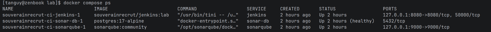

## 3. Tests automatisés et couverture

**Choix :** Jest + ts-jest (tests TypeScript typés) et supertest (requêtes HTTP réelles sur l'application Express, sans ouvrir de port). Le client Prisma est **simulé** : les tests sont rapides, déterministes et n'ont pas besoin de PostgreSQL dans la pipeline.

| Niveau | Périmètre |
|---|---|
| Unitaires (`tests/unit`) | Pagination, middlewares (JWT, rôles, validation Zod, erreurs), 8 services, configuration |
| Intégration (`tests/integration`) | Toutes les routes : authentification, utilisateurs, candidats, offres, candidatures, dashboard, santé |

Points couverts : login valide ou invalide, token absent, falsifié ou expiré (401), rôle insuffisant (403), validation (400), doublons (409), ressources absentes (404), erreur interne masquée (500), absence de l'en-tête `X-Powered-By`.

**Résultat : 19 suites, 110 tests, 100 % de couverture** (instructions, branches, fonctions, lignes). Un seuil de **80 %** est imposé dans `jest.config.js` : en dessous, la pipeline échoue.

Rapport complet : [`integration-continue/reports/couverture-tests-2026-11-09.txt`](../integration-continue/reports/couverture-tests-2026-11-09.txt)

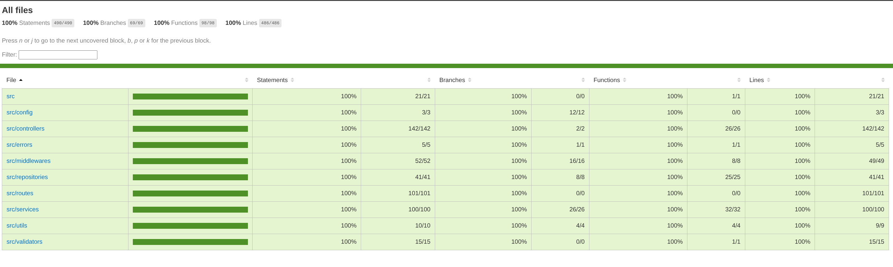

## 4. Analyse SonarQube et Quality Gate

Configuration versionnée dans `backend/sonar-project.properties` (sources, tests, exclusions, rapport `lcov`). Quality Gate : **Sonar way** (couverture du nouveau code ≥ 80 %, aucun nouveau bug ni vulnérabilité, duplications ≤ 3 %).

| Indicateur | 1re analyse | Après corrections |
|---|---|---|
| Quality Gate | Passed | **Passed** |
| Bugs | 0 | 0 |
| Vulnérabilités | 1 | **0** |
| Code smells | 2 | **0** |
| Security hotspots | 0 | 0 |
| Duplications | 0,0 % | 0,0 % |
| Couverture | 99,8 % | 99,8 % |

| Règle | Constat | Correction |
|---|---|---|
| S5689 (sécurité) | Express révèle sa présence via l'en-tête `X-Powered-By` | `app.disable("x-powered-by")` + test associé |
| S7773 ×2 | Usage de `parseInt` global | `Number.parseInt` |

Exports bruts de l'API : [`integration-continue/sonar/`](../integration-continue/sonar/)

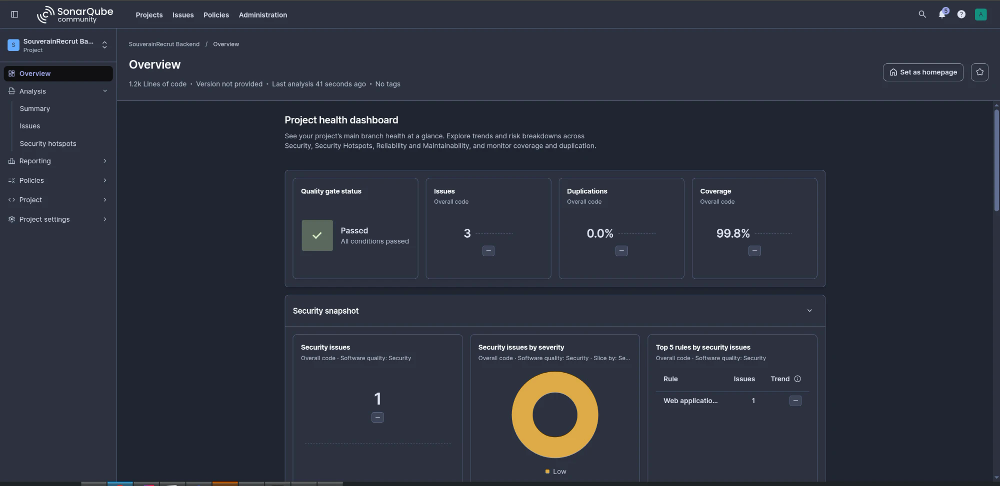
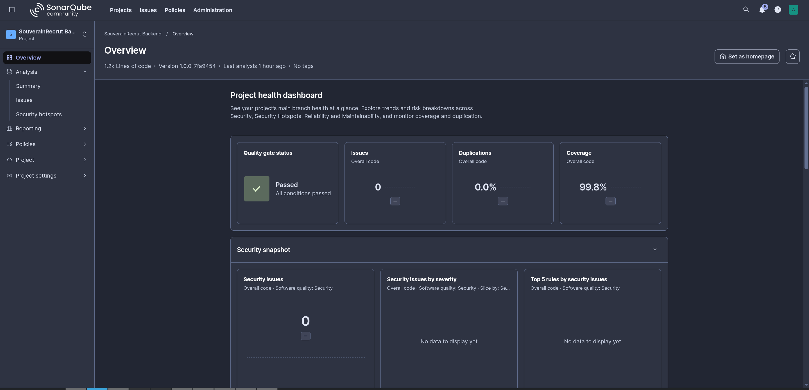

## 5. Lab Jenkins

Jenkins et SonarQube tournent en local via `integration-continue/lab/docker-compose.yml`. Le VPS de production est réservé au déploiement.

| Élément | Configuration |
|---|---|
| Image Jenkins | LTS JDK 21 + Docker CLI + Node.js 22 + plugins (Git, Pipeline, SonarQube, Credentials Binding) |
| Accès Docker | Socket de l'hôte monté : build et scan sans Docker-in-Docker |
| SonarQube | Serveur `sonarqube` déclaré dans Jenkins, scanner installé automatiquement |
| Webhook | SonarQube → `http://jenkins:8080/sonarqube-webhook/` |
| Déclencheur | Poll SCM toutes les 5 minutes |

**Choix et compromis :**
- **Ports liés à `127.0.0.1` :** rien n'est exposé sur le réseau local. Contrepartie : GitHub ne peut pas joindre Jenkins, d'où le *Poll SCM* au lieu d'un webhook GitHub.
- **Socket Docker monté :** simple et suffisant pour un lab. En production, on utiliserait un agent dédié ou un builder sans daemon.
- **Validation des webhooks locaux désactivée dans SonarQube :** acceptable ici uniquement parce que SonarQube n'est pas exposé.

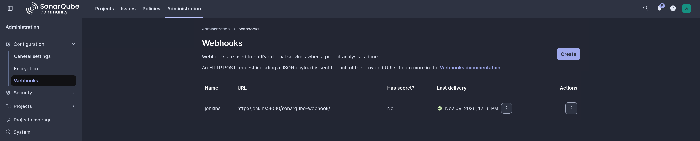
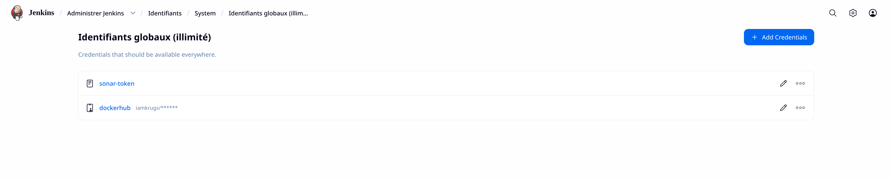
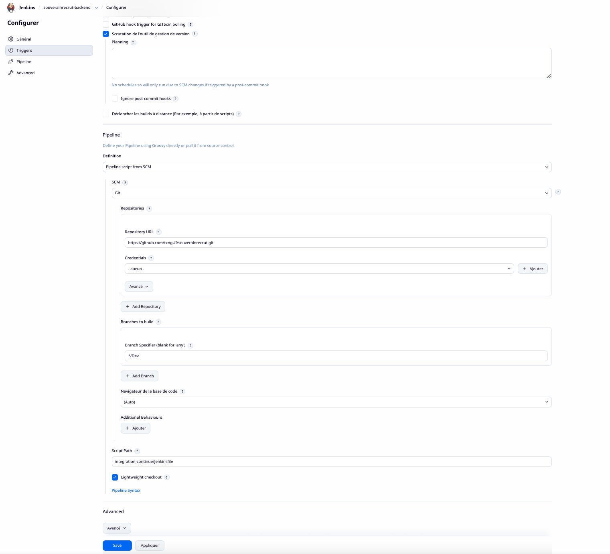

## 6. Pipeline CI (Jenkinsfile)

Fichier versionné : [`integration-continue/Jenkinsfile`](../integration-continue/Jenkinsfile)

| # | Étape | Rôle | Échec si… |
|---|---|---|---|
| 1 | Checkout | Récupère `Dev`, calcule le tag `version-sha` | — |
| 2 | Install | `npm ci` (versions exactes du lockfile) | dépendance introuvable |
| 3 | Prisma generate | Génère le client Prisma | schéma invalide |
| 4 | Lint | ESLint + vérification Prettier | règle violée |
| 5 | Tests | Tests + couverture | test rouge ou couverture < 80 % |
| 6 | SonarQube | Envoie l'analyse | — |
| 7 | Quality Gate | Attend le verdict de SonarQube (webhook) | gate rouge |
| 8 | Docker build | Image taguée et étiquetée (version, commit, source) | build KO |
| 9 | Trivy | Rapport archivé + contrôle bloquant | HIGH/CRITICAL corrigeable non justifiée |
| 10 | Publish | `docker push` (branche `Dev` uniquement) | authentification KO |

Les étapes sont séquentielles : **un échec arrête la pipeline, et l'image n'est pas publiée**.

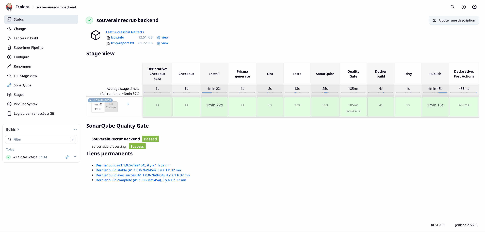
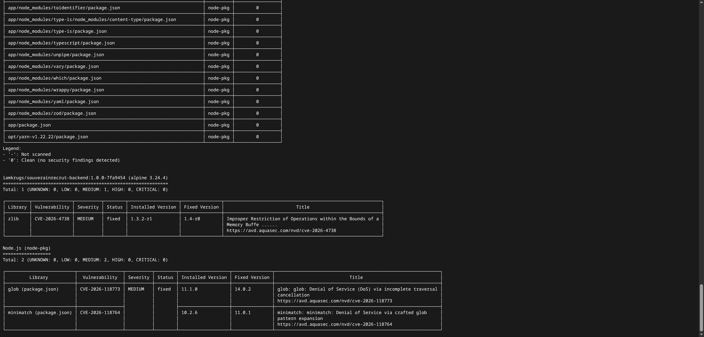

## 7. Image Docker et scan Trivy

**Dockerfile** (`backend/Dockerfile`) : build multi-stage `node:22-alpine`. L'image finale ne contient que `dist/`, les dépendances de production et le client Prisma. Autres caractéristiques :
- utilisateur **non-root** (`node`) ;
- **healthcheck** sur `/v1/health` ;
- npm et npx retirés ;
- `.dockerignore` excluant `.env`, les tests et `node_modules`.

**Politique Trivy (seuils acceptés) :**
- **bloquant :** toute vulnérabilité **HIGH ou CRITICAL disposant d'un correctif** ;
- **toléré :** MEDIUM et LOW, reportés dans le rapport ;
- **exceptions :** déclarées dans `backend/.trivyignore.yaml`, chacune **justifiée et datée**. À expiration, elle redevient bloquante.

| Scan de l'image | CRITICAL | HIGH | MEDIUM |
|---|---|---|---|
| Image d'origine (Node 20, root, avec npm) | 1 | 26 | — |
| Après corrections (`npm audit fix`, npm retiré) | **0** | 1 (exception) | 3 |

Exception en vigueur : **CVE-2026-40345** (`deepmerge-ts`, dépendance interne de l'outillage Prisma, non atteignable par les requêtes HTTP). Son correctif impose Prisma 7 ; l'exception expire le 31/12/2026.

Rapport complet : [`integration-continue/reports/trivy-1.0.0-7fa9454.txt`](../integration-continue/reports/trivy-1.0.0-7fa9454.txt)

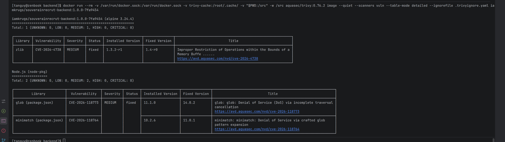

## 8. Publication Docker Hub

L'image est publiée avec deux tags traçables, sans `latest` :

- `iamkrugs/souverainrecrut-backend:1.0.0-7fa9454` : version applicative + commit ;
- `iamkrugs/souverainrecrut-backend:sha-7fa9454` : commit seul.

Les labels OCI (`org.opencontainers.image.revision`, `version`, `source`) relient l'image au commit Git.

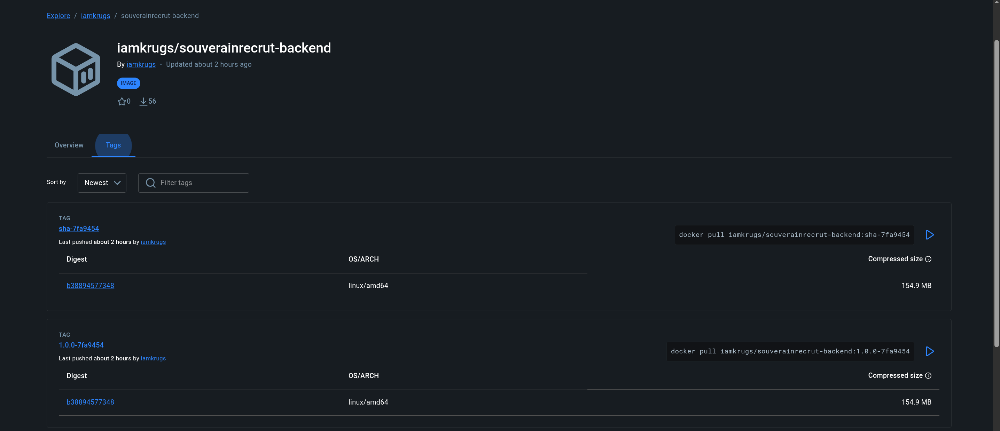

## 9. Gestion des secrets

Aucun secret dans le dépôt, le Jenkinsfile, l'image ou les logs. Les tokens SonarQube et Docker Hub sont stockés dans les **credentials Jenkins**, et le mot de passe de la base SonarQube dans un `.env` non versionné. La connexion à Docker Hub utilise `--password-stdin`, et les logs affichent `****`.

Le token est masqué (`echo ****`) dans les logs. L'avertissement Docker sur le stockage local des identifiants (`~/.docker/config.json`) est traité par un `docker logout` systématique en fin de pipeline (bloc `post { always }`).

Inventaire complet, procédures de création, de rotation et de révocation : [`gestion-des-secrets.md`](gestion-des-secrets.md)

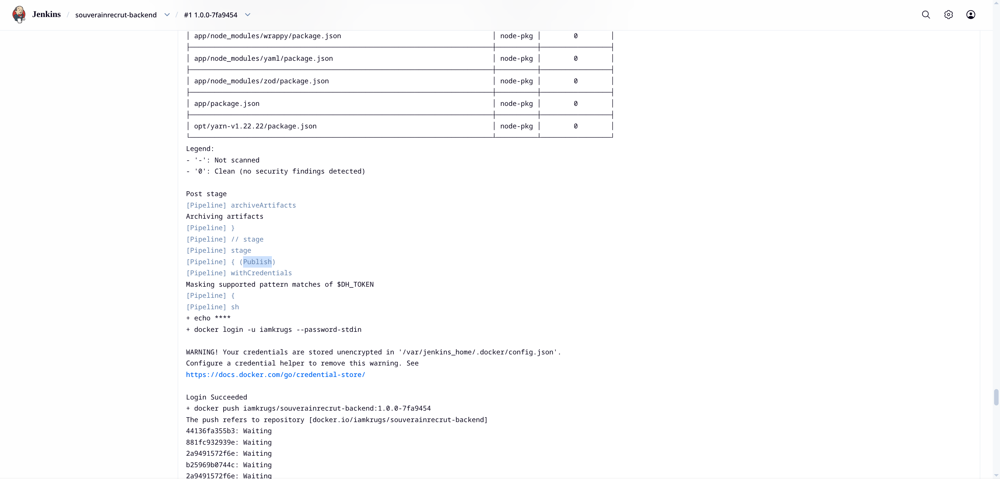

## 10. Bilan et pistes d'amélioration

**Bilan :** la chaîne CI est complète et automatisée, de `git push` à l'image publiée. Elle comporte trois barrières bloquantes : tests et couverture, Quality Gate, Trivy.

**Démonstration d'un blocage :** le build n°2 a été rejoué (*Replay*) avec un seuil Trivy durci (`--severity MEDIUM,HIGH,CRITICAL`). Trivy détecte les 3 vulnérabilités MEDIUM et renvoie un code de sortie non nul. L'étape *Trivy* échoue, *Publish* n'est pas exécutée et aucune image n'est poussée. Le Quality Gate, lui, reste *Passed* : chaque barrière est indépendante.

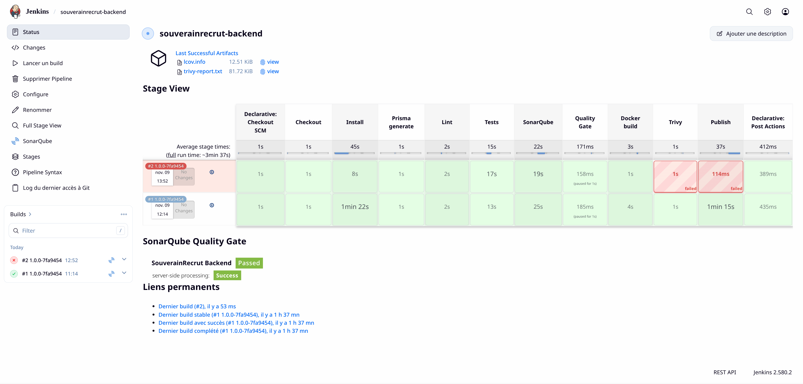

**Pistes d'amélioration :**

- Migrer vers Prisma 7, ce qui lève l'exception Trivy.
- Exposer Jenkins de façon sécurisée pour remplacer le Poll SCM par un webhook GitHub.
- Ajouter un scan de secrets (gitleaks) et un audit de dépendances (`npm audit`) dans la pipeline.
- Construire l'image sur un agent dédié plutôt que via le socket Docker de l'hôte.

## 11. Déploiement (jour 2)

Documentation technique détaillée : [`deploiement/README.md`](../deploiement/README.md)

### 11.1 Serveur cible

Le serveur cible est un **VPS** (PulseHeberg, Ubuntu 24.04, IP publique) au lieu d'une VM VMware locale :

- il est joignable par les runners GitLab.com, ce qui n'est pas possible pour une VM en NAT ;
- il est représentatif d'une vraie production : exposition Internet, DNS, TLS.

Ce serveur héberge déjà d'autres services (sites derrière Caddy, Minecraft). Le déploiement est donc **isolé** :

- un projet Compose dédié ;
- aucun port public ouvert ;
- un fichier Caddy dédié ;
- le service Docker n'est jamais redémarré.

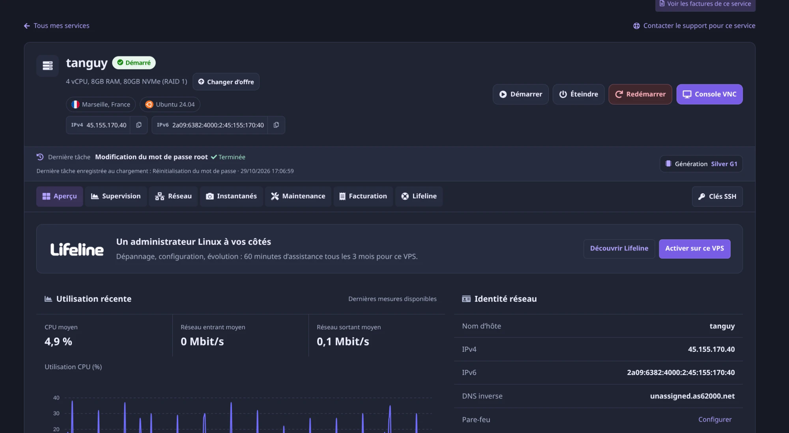

L'offre du VPS n'inclut pas d'instantanés. Le point de restauration demandé au §4.1 est remplacé par trois mesures :

- une **sauvegarde ciblée** de la configuration (Caddy, SSH, comptes) avant toute modification ;
- des **modifications uniquement additives** et réversibles ;
- une **simulation Ansible** (`--check --diff`) avant application.

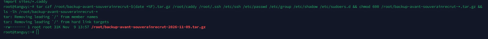

### 11.2 Terraform : DNS de l'API

PulseHeberg n'ayant pas de provider Terraform, le VPS est créé manuellement (cas prévu au §4.2). Terraform pilote la ressource réellement disponible : la **zone DNS `tanguydavid.fr` chez Hostinger** (provider officiel `hostinger/hostinger`). Il crée les enregistrements `A` et `AAAA` de `api.tanguydavid.fr` vers le serveur.

- **Sécurité :** le token API est lu dans `HOSTINGER_API_TOKEN`, saisi sans affichage. L'état `tfstate` n'est jamais versionné.
- **Non-régression :** `overwrite = false`, donc aucun enregistrement existant n'est remplacé. Avant d'appliquer, on a vérifié qu'aucun enregistrement `api` ni wildcard n'existait.
- **Commandes :** `terraform init`, `validate`, `plan -out=tfplan`, `apply tfplan`.
- **Résultat :** plan `2 to add, 0 to change, 0 to destroy`, puis `Apply complete! Resources: 2 added`. Vérifié par `dig` : `api.tanguydavid.fr` résout vers les IPv4 et IPv6 du serveur.

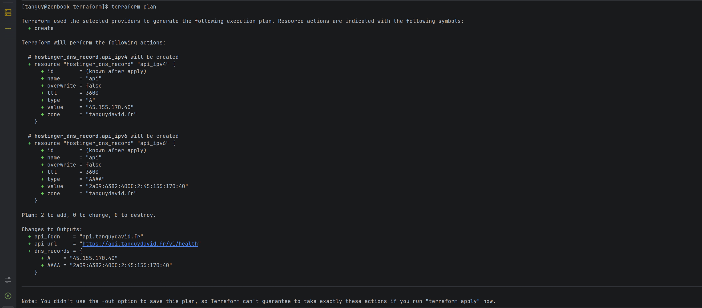
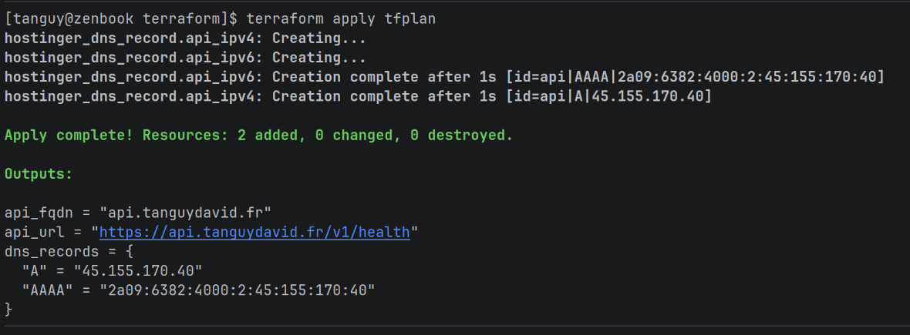

### 11.3 Accès SSH : deux clés, deux rôles

| Clé | Utilisée par | Compte | Droits |
|---|---|---|---|
| Clé personnelle (`id_ed25519`) | Ansible, depuis le poste d'administration | `root` | Administration du serveur |
| Clé de déploiement (`souverainrecrut_deploy`) | GitLab CI | `souverainrecrut` | Groupe `docker`, **sans sudo**, mot de passe verrouillé |

Un compte `deploy` existait déjà sur le serveur pour un autre projet. Un **compte dédié** a été créé : chaque projet peut ainsi être révoqué indépendamment, et ses connexions sont traçables séparément dans les journaux SSH.

### 11.4 Ansible : préparation du serveur

Le playbook répond aux exigences du §4.3 : système et dépendances, Docker Engine et Compose, service Docker actif, répertoire de déploiement. Il est conçu pour un **serveur partagé** :

- **Mises à jour :** uniquement les mises à jour de sécurité automatiques. Pas d'`apt upgrade` complet ni de redémarrage, qui interrompraient les services hébergés.
- **Docker :** installé **seulement s'il est absent**, et le service n'est jamais redémarré.
- **Utilisateur :** création du compte `souverainrecrut`, avec sa clé et `/opt/souverainrecrut` (`0750`).
- **Caddy :** dépôt d'un fichier de site dédié, `caddy validate` puis `caddy reload` à chaud. Si la configuration est invalide, le fichier est retiré automatiquement (`block`/`rescue`).

| Exécution | Résultat |
|---|---|
| Simulation `--check --diff` | `changed=6 failed=0` ; partie Docker *skipped* car déjà installé |
| Application | `failed=0` ; site existant toujours en ligne ; certificat Let's Encrypt obtenu pour `api.tanguydavid.fr` |
| Application rejouée | `changed=0 failed=0` : **idempotence** vérifiée |

Rapports : [`deploiement/reports/`](../deploiement/reports/)

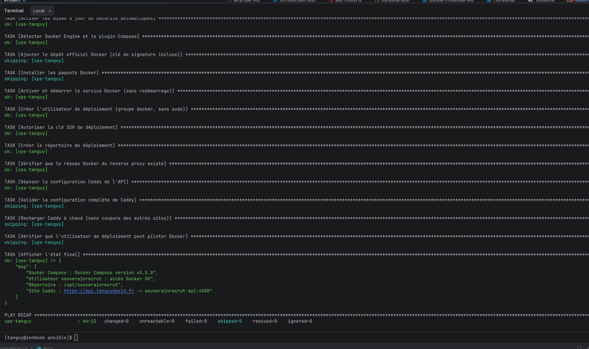
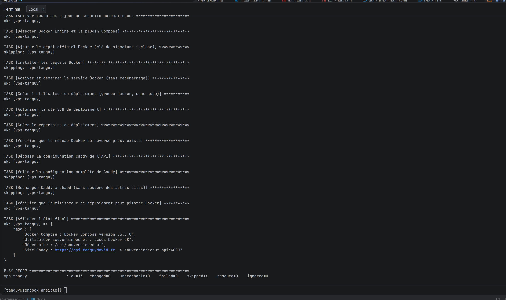
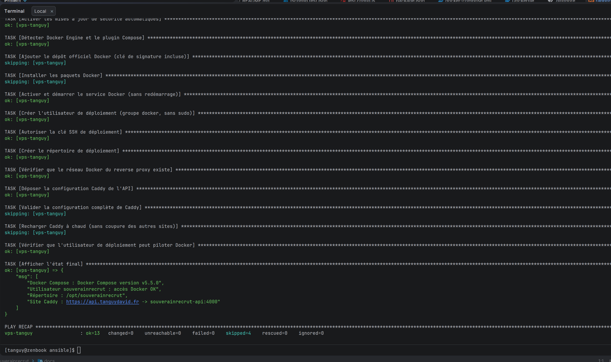

### 11.5 Docker Compose et premier déploiement

Fichiers : `deploiement/deployment/docker-compose.yml` et `.env.example`.

| Exigence §5.2 | Mise en œuvre |
|---|---|
| Image versionnée | `iamkrugs/souverainrecrut-backend:${BACKEND_TAG}`, jamais reconstruite ni `latest` |
| Variables API et Prisma | `.env` sur le serveur, droits 600, non versionné ; secrets générés sur place (`openssl rand`) |
| Volume persistant | `db_data` (PostgreSQL) |
| Réseaux | `backend` **interne** (API ↔ base, sans Internet) ; `web` (Caddy ↔ API, alias `souverainrecrut-api`) ; **aucun port publié** |
| Redémarrage et santé | `restart: unless-stopped` ; `pg_isready` pour la base ; `/v1/health` pour l'API |
| Migrations maîtrisées | Conteneur ponctuel `migrate` (`prisma migrate deploy`). L'API ne démarre que si les migrations réussissent. Le seed de démonstration n'est **pas** exécuté en production, car il vide les tables. |

Ce fichier a d'abord été **testé en local**, avec l'image publiée :
- migrations appliquées, API *healthy*, `/v1/ready` → `READY / CONNECTED` ;
- redéploiement : `No pending migrations` ;
- base injoignable depuis le réseau de Caddy.

Il a ensuite été déployé sur le serveur avec le compte de déploiement.

**Résultat :**
- `api` et `db` sont *healthy*, `migrate` s'est terminé avec le code 0 ;
- `https://api.tanguydavid.fr/v1/ready` → `READY / CONNECTED` ;
- Swagger est accessible sur `/api-docs`.

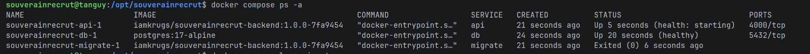
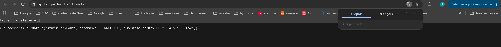
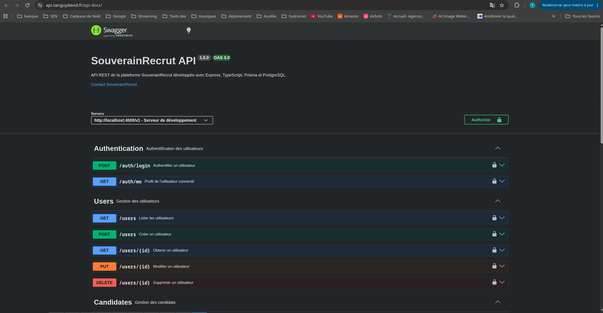

### 11.6 Pipeline GitLab CI/CD

GitLab.com (offre cloud, runners hébergés) prend en charge le **déploiement continu**, séparé de l'intégration continue faite par Jenkins :

- Jenkins s'arrête à l'image publiée sur Docker Hub ;
- GitLab part d'un **tag d'image** et le met en production.

**Mise en place du projet GitLab :**

| Étape | Réalisation |
|---|---|
| Compte et espace | Compte GitLab.com (offre Free, runners hébergés) ; groupe `tanguy-cicd` |
| Projet dédié au déploiement (§4.4) | `souverainrecrut-deploiement`, **privé** ; branche `main` protégée |
| Authentification Git | Clé SSH personnelle ajoutée au profil GitLab ; empreinte de `gitlab.com` vérifiée (`SHA256:eUXGGm1Y…CLB8`) |
| Contenu | Le dossier `deploiement/` du dépôt GitHub est publié à la racine du projet GitLab avec `git subtree`. Le dépôt GitHub reste la **source unique**, et `.gitlab-ci.yml` est à la racine côté GitLab. |
| Contrôle avant publication | Scan gitleaks du contenu commité : `no leaks found` ; état Terraform ignoré par Git |

Pousser n'exécute rien : la pipeline se déclenche **uniquement manuellement** (règle `workflow`).

| Job | Rôle |
|---|---|
| `validate-tag` | Refuse un tag mal formé ou `latest` ; vérifie sur Docker Hub que l'image existe |
| `deploy-production` | Envoie le fichier Compose en SSH (empreinte du serveur vérifiée) ; **sauvegarde la base** (`pg_dump`, 5 dernières conservées) ; met à jour `BACKEND_TAG` ; lance `pull` et `up --wait`. **En cas d'échec, revient automatiquement au tag précédent.** Journalise dans `deploy-history.log`. |
| `verify-api` | Vérifie que `/v1/ready` répond `READY` |

Déclenchement manuel : le tag à déployer est saisi dans le formulaire de lancement, via un **input** de pipeline (`spec:inputs`, mécanisme recommandé par GitLab à la place des variables libres). `resource_group` garantit un seul déploiement à la fois. L'environnement GitLab `production` conserve l'historique des déploiements.

**Secrets :** GitLab ne reçoit que ce que liste le §4.4 :
- la clé SSH (variable de type *File*, protégée) ;
- l'empreinte du serveur ;
- l'adresse et l'utilisateur ;
- les identifiants Docker Hub : **volontairement non créés**. L'image est publique, et la pipeline saute la connexion si ces variables sont absentes. Un secret en moins dans la CI.

Les 4 variables créées (`SSH_PRIVATE_KEY` de type *File*, `SSH_KNOWN_HOSTS`, `DEPLOY_HOST`, `DEPLOY_USER`) sont toutes *Protected* : elles ne sont transmises qu'à la branche protégée `main`. L'empreinte du serveur a été comparée à celle déjà connue du poste d'administration (`SHA256:cHakt12…dikx1Q`).

Les secrets applicatifs **restent uniquement sur le serveur** : la pipeline ne modifie que `BACKEND_TAG`.

**Résultat du premier déploiement par la pipeline** (pipeline 3045841142, tag `1.0.0-7fa9454`) :
- les 3 jobs sont verts ;
- la base a été sauvegardée avant le déploiement ;
- le déploiement est journalisé sur le serveur ;
- l'API répond `READY / CONNECTED`.

**Difficultés rencontrées et résolues :**
- syntaxe YAML d'une ligne de script ;
- passage du tag en *input* de pipeline (`spec:inputs`), car les variables manuelles sont désactivées par défaut ;
- format de la clé collée dans la variable : la pipeline normalise désormais la clé et vérifie sa lisibilité avant usage ;
- **clé privée exposée** dans une capture pendant le diagnostic : elle a été traitée comme un incident, avec **rotation immédiate**. Ansible gère `authorized_keys` en mode exclusif, ce qui a révoqué automatiquement l'ancienne clé. L'empreinte de la clé autorisée a été vérifiée et le redéploiement a réussi (`gestion-des-secrets.md` §4.1).

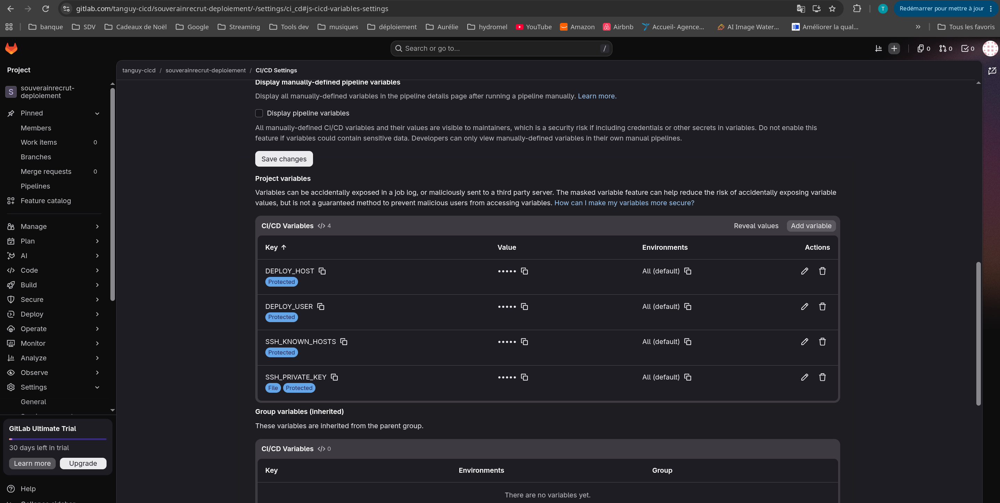
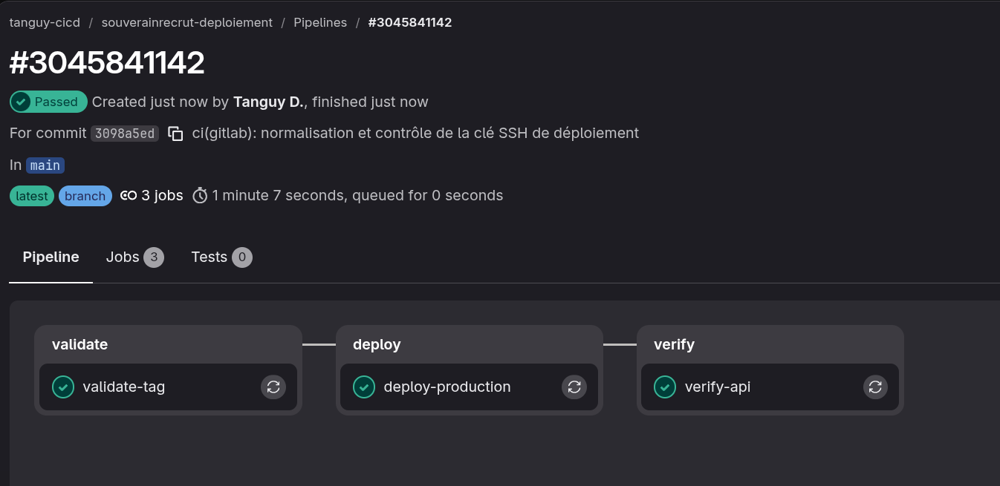
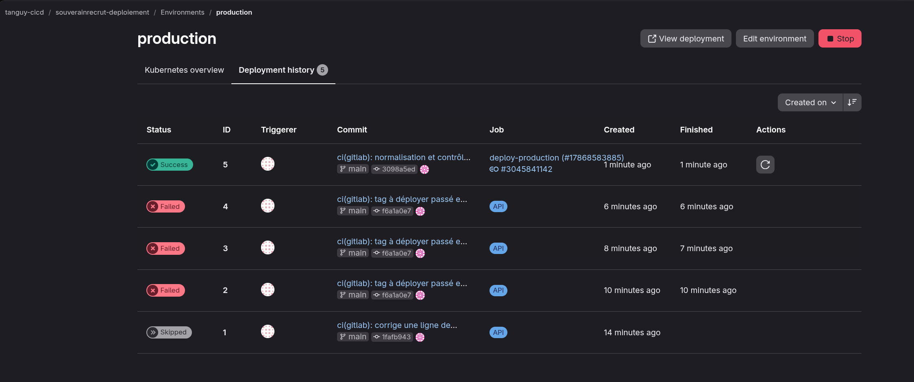

### 11.7 Retour arrière (rollback)

| Situation | Action |
|---|---|
| Le nouveau tag ne démarre pas | **Automatique** : la pipeline remet le tag précédent et redémarre |
| Régression détectée après déploiement | Relancer la pipeline avec le tag précédent, ou **Re-deploy** sur l'ancien déploiement dans *Environments → production* |
| Migration de base incompatible | Restaurer la sauvegarde `backups/db-…-avant-<tag>.sql.gz` prise automatiquement avant le déploiement, puis redéployer l'ancien tag |

Procédure détaillée et **testée** (restauration de la base vérifiée sur une copie locale) : [`procedure-rollback.md`](procedure-rollback.md).

### 11.8 Documentation de référence

| Document | Contenu |
|---|---|
| [`architecture.md`](architecture.md) | Vue d'ensemble, composants, flux du commit au déploiement, réseau, secrets, choix techniques |
| [`procedure-deploiement.md`](procedure-deploiement.md) | Mise en place initiale, déploiement courant, vérifications, déploiement de secours, dépannage |
| [`procedure-rollback.md`](procedure-rollback.md) | Retour automatique, redéploiement d'un tag, restauration de la base, configuration du serveur |
| [`gestion-des-secrets.md`](gestion-des-secrets.md) | Inventaire, création, rotation, incident traité |

---

## Annexe A : commandes exécutées

Les commandes sont listées dans l'ordre de réalisation. Les secrets sont toujours saisis sans affichage (`read -rsp`) ou générés sur place, et n'apparaissent jamais en clair.

### A.1 Tests, lint et couverture (`backend/`)

```bash
npm ci
npx prisma generate
npm install -D jest ts-jest @types/jest supertest @types/supertest
npm install -D eslint @eslint/js typescript-eslint globals prettier eslint-config-prettier
npm run lint                  # ESLint
npm run format:check          # Prettier (vérification)
npm test                      # 110 tests
npm run test:coverage         # couverture + coverage/lcov.info
npm audit fix                 # correctifs de dépendances (sans --force)
```

### A.2 Lab Jenkins + SonarQube (`integration-continue/lab/`)

```bash
printf "SONAR_DB_PASSWORD=%s\nDOCKER_GID=%s\n" "$(openssl rand -hex 16)" \
  "$(getent group docker | cut -d: -f3)" > .env          # .env non versionné
git check-ignore -v .env                                # vérifie qu'il est ignoré
docker compose up -d --build                            # Jenkins + SonarQube + PostgreSQL
docker compose ps
docker compose logs -f sonarqube                        # attendre "SonarQube is operational"
docker compose exec jenkins cat /var/jenkins_home/secrets/initialAdminPassword
docker compose exec jenkins docker ps                   # Jenkins accède à Docker
docker compose exec jenkins node -v                     # Node.js 22 disponible
```

### A.3 Analyse SonarQube manuelle (`backend/`)

```bash
npm run test:coverage
read -rsp "Token Sonar : " SONAR_TOKEN && export SONAR_TOKEN
docker run --rm --network souverainrecrut-ci_default \
  -e SONAR_HOST_URL=http://sonarqube:9000 -e SONAR_TOKEN \
  -v "$PWD:/usr/src" sonarsource/sonar-scanner-cli
# Exports des résultats (API SonarQube)
curl -s -u "$SONAR_TOKEN:" "http://localhost:9000/api/issues/search?componentKeys=souverainrecrut-backend&ps=100"  # gitleaks:allow (variable, aucun secret)
curl -s -u "$SONAR_TOKEN:" "http://localhost:9000/api/measures/component?component=souverainrecrut-backend&metricKeys=coverage,duplicated_lines_density,bugs,vulnerabilities,code_smells,security_hotspots,ncloc"  # gitleaks:allow (variable, aucun secret)
curl -s -u "$SONAR_TOKEN:" "http://localhost:9000/api/qualitygates/project_status?projectKey=souverainrecrut-backend"  # gitleaks:allow (variable, aucun secret)
```

### A.4 Image Docker et Trivy

```bash
docker build -t iamkrugs/souverainrecrut-backend:test backend
docker run --rm -v /var/run/docker.sock:/var/run/docker.sock -v trivy-cache:/root/.cache/ \
  -v "$PWD:/src" -w /src aquasec/trivy:0.76.2 image --scanners vuln \
  --severity HIGH,CRITICAL --ignore-unfixed --exit-code 1 \
  --ignorefile backend/.trivyignore.yaml iamkrugs/souverainrecrut-backend:1.0.0-7fa9454
# Version courte (vulnérabilités uniquement)
docker run --rm -v /var/run/docker.sock:/var/run/docker.sock -v trivy-cache:/root/.cache/ \
  -v "$PWD:/src" -w /src aquasec/trivy:0.76.2 image --scanners vuln --table-mode detailed \
  --ignorefile backend/.trivyignore.yaml iamkrugs/souverainrecrut-backend:1.0.0-7fa9454
```

Dans la pipeline Jenkins, la publication se fait par `echo "$DH_TOKEN" | docker login -u "$DH_USER" --password-stdin`, puis `docker push` des tags `1.0.0-<sha7>` et `sha-<sha7>`.

### A.5 Contrôle des secrets (racine du dépôt)

```bash
docker run --rm -v "$PWD:/repo" zricethezav/gitleaks:latest detect --source /repo   # → no leaks found
git ls-files | grep -E '(^|/)\.env'                                                # seuls des .env.example
```

### A.6 Serveur : état des lieux et sauvegarde (VPS, en root)

```bash
docker --version; docker compose version; ss -tlnp      # ports et services existants
docker ps --format 'table {{.Names}}\t{{.Image}}\t{{.Ports}}'
docker network ls
tar czf /root/backup-avant-souverainrecrut-$(date +%F).tar.gz \
  /root/caddy /root/.ssh /etc/ssh /etc/passwd /etc/group /etc/shadow /etc/sudoers.d
chmod 600 /root/backup-avant-souverainrecrut-*.tar.gz
```

### A.7 Terraform (`deploiement/terraform/`)

```bash
dig +short api.tanguydavid.fr A                         # vérifier qu'aucun enregistrement n'existe
read -rsp "Token Hostinger : " HOSTINGER_API_TOKEN && export HOSTINGER_API_TOKEN
terraform init
terraform validate
terraform plan -out=tfplan                              # 2 to add, 0 to change, 0 to destroy
terraform apply tfplan
terraform output
dig +short api.tanguydavid.fr A && dig +short api.tanguydavid.fr AAAA
```

### A.8 Clés SSH (poste d'administration)

```bash
ssh-copy-id -i ~/.ssh/id_ed25519.pub root@45.155.170.40          # accès Ansible par clé
ssh root@45.155.170.40 'echo OK && python3 --version'
ssh-keygen -t ed25519 -C "deploy-souverainrecrut" -f ~/.ssh/souverainrecrut_deploy -N ""
```

### A.9 Ansible (`deploiement/ansible/`)

```bash
ansible production -m ping
ansible-playbook playbook.yml --check --diff            # simulation
ansible-playbook playbook.yml --diff                    # application
ansible-playbook playbook.yml --diff | tee ../reports/ansible-apply-2026-11-09.txt   # rejouée : changed=0
ssh -i ~/.ssh/souverainrecrut_deploy souverainrecrut@45.155.170.40 'whoami && id && ls -ld /opt/souverainrecrut'
```

### A.10 Premier déploiement manuel

```bash
# Poste d'administration (racine du dépôt)
scp -i ~/.ssh/souverainrecrut_deploy deploiement/deployment/docker-compose.yml \
  souverainrecrut@45.155.170.40:/opt/souverainrecrut/
ssh -i ~/.ssh/souverainrecrut_deploy souverainrecrut@45.155.170.40

# Serveur (compte souverainrecrut) : .env créé avec les droits 600, secrets générés sur place
cd /opt/souverainrecrut && umask 077 && printf "BACKEND_IMAGE=iamkrugs/souverainrecrut-backend\nBACKEND_TAG=1.0.0-7fa9454\nPOSTGRES_DB=souverainrecrut\nPOSTGRES_USER=souverainrecrut\nPOSTGRES_PASSWORD=%s\nJWT_SECRET=%s\nFRONTEND_URL=https://tanguydavid.fr\n" "$(openssl rand -hex 24)" "$(openssl rand -hex 32)" > .env
docker compose pull
docker compose up -d
docker compose ps -a
docker compose logs migrate

# Vérification publique
curl -s https://api.tanguydavid.fr/v1/health
curl -s https://api.tanguydavid.fr/v1/ready
```

### A.11 Publication vers GitLab (racine du dépôt)

```bash
ssh -T git@gitlab.com                                   # → Welcome to GitLab, @txngUI!
git add deploiement documentation
git commit -m "deploiement: Terraform DNS, Ansible, Docker Compose, pipeline GitLab CI/CD, rapport jour 2"
git push origin Dev                                     # GitHub : dépôt de livrable
git remote add gitlab git@gitlab.com:tanguy-cicd/souverainrecrut-deploiement.git
git subtree push --prefix deploiement gitlab main       # GitLab : dossier deploiement/ à la racine
```

### A.12 Valeurs non secrètes des variables GitLab

```bash
ssh-keyscan -t ed25519 45.155.170.40                    # → SSH_KNOWN_HOSTS
ssh-keyscan -t ed25519 45.155.170.40 | ssh-keygen -lf - # contrôle : SHA256:cHakt12…dikx1Q
ssh-keygen -F 45.155.170.40 | ssh-keygen -lf -          # identique à l'empreinte déjà connue du poste
```

### A.13 Rotation de la clé de déploiement et lancement de la pipeline

```bash
ssh-keygen -t ed25519 -C "deploy-souverainrecrut" -f ~/.ssh/souverainrecrut_deploy -N ""   # nouvelle clé
cd deploiement/ansible && ansible-playbook playbook.yml --diff                           # ancienne retirée, nouvelle ajoutée
ssh -i ~/.ssh/souverainrecrut_deploy souverainrecrut@45.155.170.40 whoami                # vérification
# GitLab : Settings > CI/CD > Variables > SSH_PRIVATE_KEY remplacée (sans capture de la valeur)
# GitLab : Build > Pipelines > New pipeline > input backend_tag = 1.0.0-7fa9454
git subtree push --prefix deploiement gitlab main                                         # à chaque modification de deploiement/
```
